# Edge Gateway

## CM upgrade to manage Edge Gateway

1.	Log in to **cm** cli and execute *Edge Gateway* patch retrieval process.

    !!! note "parameters:"
        - Host: **raptor.demo.guardium**
        - User: **root** 
        - Path: **/opt/guardium_tz_bootcamp_automation/upload/source_files/appliances/extensions/SqlGuard-12.0p15004_Edge_Sep_02_2026.tgz.enc.sig**
        - Port: **2223**
        - Password: **&lt;default service password>**
      
    ```bash
    store system patch install scp
    ```
    Monitor the progress as the patch downloads to the appliance, noting that the large file size may require a while to complete. Once the download finishes and the patch appears in the available list, do not initiate the installation from the command line. Because this specific update must be managed via the User Interface (*UI*) or the *API*, finish the current cli command by selecting the `q` option.

    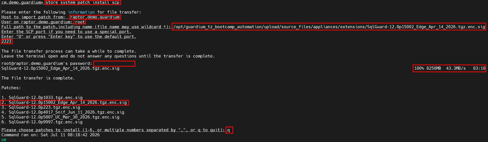{ width="99%" }
 
1.	Register patch and retrieve information about it (because patch is huge it takes time).
```bash
show system patch available
```
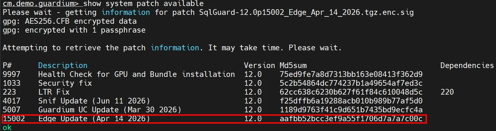{ width="99%" }
 
1.	From **cm** UI open **Patch Management** view. Select the *Central Manager* <span class="mb">1</span> and locate the patch <span class="mb">2</span> that was just uploaded to the system. Trigger the installation process by clicking the **Install** option <span class="mb">3</span>. Choose the immediate installation <span class="mb">4</span> and confirm your selection <span class="mb">5</span> to finalize the task. The system will then schedule the specified patch for deployment
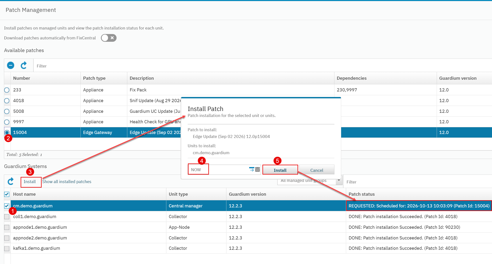{ width="99%" }
 
1.	While the patch installation runs in the background, shift your focus to the additional laboratory tasks to maintain workflow efficiency.

## Start traffic generator - MSSQL on ceratops

1.	Start dbtraffic generator on **raptor** and keep this session running
```bash linenums="1"
cd /opt/guardium_tz_bootcamp_automation/upload/guardium_notes_dbtraffic

source venv/bin/activate

guardium-notes-dbtraffic --config config/mssql_ceratops.yaml rebuild

guardium-notes-dbtraffic --config config/mssql_ceratops.yaml run --speed slow
```

1. Confirm on **coll1** the visibility the *MSSQL* events in Full *SQL (Training)* report.
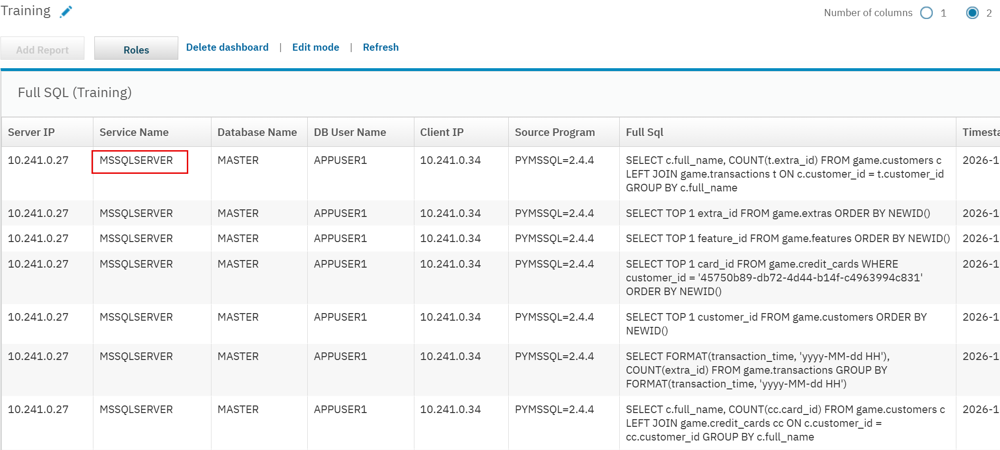{ width="99%" }

## K3s installation

1.	Deploy a *k3s* cluster on the **sauropod** machine. Configure the installation to disable the default traefik service to ensure the *Edge Gateway* can utilize the preferred routing mechanism based on **nginx** proxy.
```bash
curl -sfL https://get.k3s.io | INSTALL_K3S_VERSION=v1.32.13+k3s1 sh -s - --disable traefik
```

1.	Check node readiness.
```bash linenums="1"
kubectl get nodes

kubectl get pods -A
```
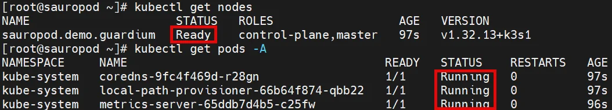{ width="99%" }

1.	Add the name resolving for *cm.gdemo.com* within the cluster configuration. Ensure that the host entry is correctly mapped to allow multiple services to establish a connection with the *Central Manager*.
```bash linenums="1"
kubectl -n kube-system patch configmap coredns --type='json' -p='[{"op":"replace","path":"/data/NodeHosts","value":"<sauropod_ip> sauropod.demo.guardium\n<cm_ip> cm.demo.guardium\n<cm_ip> cm.demo.guardium.demo.guardium\n"}]'

kubectl -n kube-system patch configmap coredns --type=json -p='[{"op":"replace","path":"/data/Corefile","value":".:53 {\n    errors\n    health\n    ready\n    kubernetes cluster.local in-addr.arpa ip6.arpa {\n        pods insecure\n        fallthrough in-addr.arpa ip6.arpa\n    }\n    hosts {\n        <cm_ip> cm.demo.guardium\n        <cm_ip> cm.demo.guardium.demo.guardium\n        fallthrough\n    }\n    prometheus :9153\n    forward . /etc/resolv.conf\n    cache 30\n    loop\n    reload\n    loadbalance\n}\n"}]'

kubectl -n kube-system rollout restart deployment coredns
```

## Setup Edge Gateway config on CM

1.	Confirm the installation of patch **15004** from the cm command line. If the installation is still in progress, wait for the process to be completed before proceeding.
```bash
show system patch installed
```
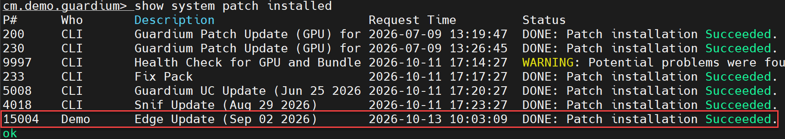{ width="99%" }

1.	Check that feature flag responsible for *Edge Gateway* is enabled.
```bash
grdapi list_feature_flags
``` 
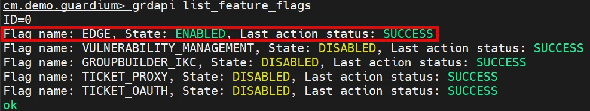{ width="99%" }

1.	Access the *Central Manager* view within the **cm** UI and select *Register Edge Gateway* from the **Actions** dropdown menu. In the registration window, enter the required information and press **Register Edge Gateway** button.

    !!! note "Edge parameters:"
        - Edge name: **sauropod** (name cannot include dots and special characters)
        - Namespace: **edge** (namespace where Edge Gateway will be deployed)
        - Storage class: **local-path** (storage class used by the Edge Gateway; it must support RWO mode)
        - Export to: **cm.demo.guardium** (aggregator for audited events; for this lab, we are using the *Central Manager*; you can also have *LTR* datalake option if you finished *LTR* lab before)
        - Version: **v2.2.1** (Edge Gateway version to be installed)
        - Use HAProxy for ingress: **:material-check:** (routing between services and the aggregator will be configured via *HAProxy*)

    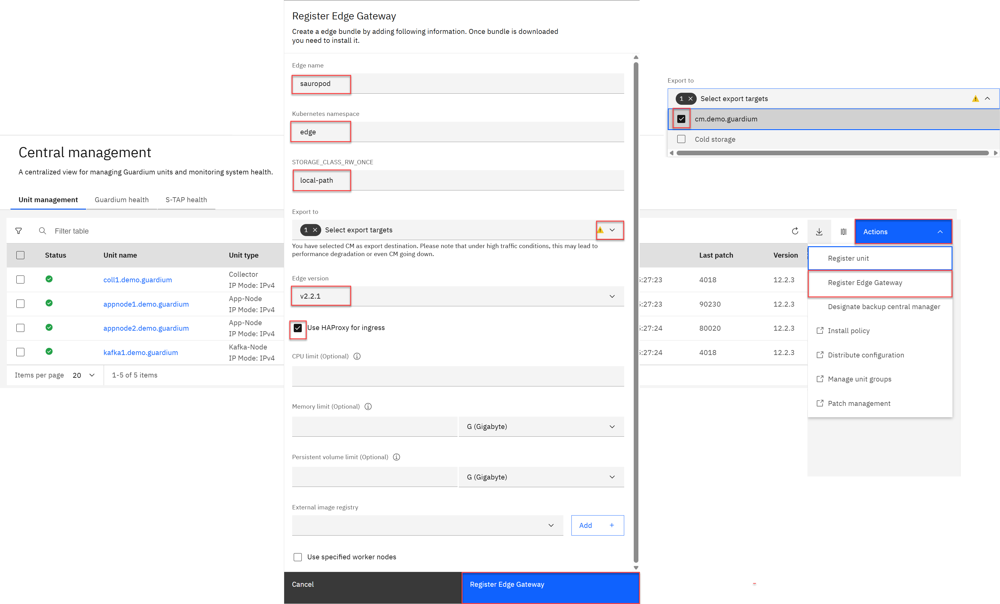{ width="99%" }
 
1.	The **Install edge bundle** window will appear along with a prompt to save the generated deployment archive. Skip the file saving, we will donwload it through the `curl` command displayed in the window. Copy command using :material-content-copy: icon.
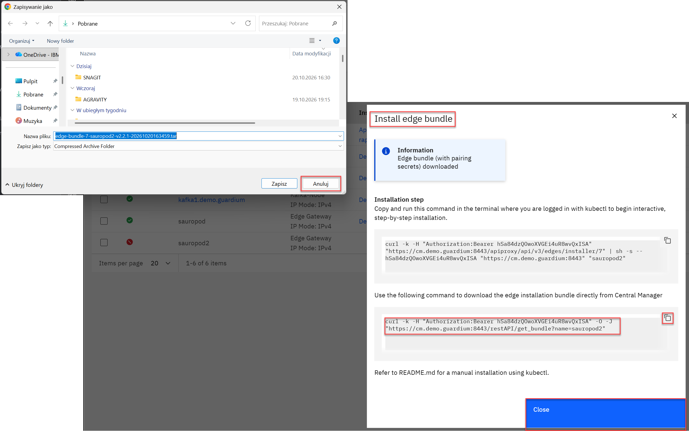{ width="99%" }
 
1.	On sauropod jump to `/opt/lab_files/` directory and execute a copied command to download deployment bundle script.
```bash linenums="1"
cd cd /opt/lab_files/

curl -k -H "Authorization:Bearer <token displayed in UI>" -O -J "https://cm.demo.guardium:8443/restAPI/get_bundle?name=sauropod"

ls
```
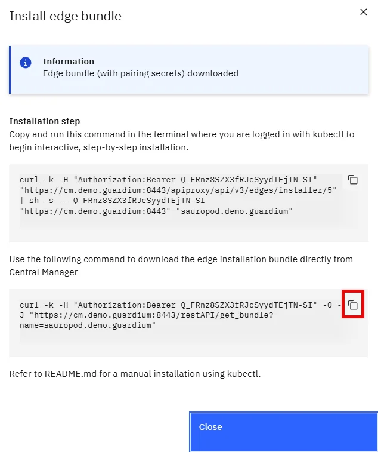{ width="99%" }

1.	Unpack downloaded archive. Exracted files will be located in `/opt/lab-files/sauropod` directory.
```bash
tar xvf <bundle_archive>
```
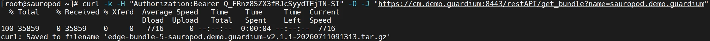{ width="89%" }

## Edge Gateway deployment

1.	The deployment initialization script requires the `expect` tool on **sauropod**.
```bash
dnf -y install expect
```

1. Open the required kubernetes ports.
```bash linenums="1"
firewall-cmd --permanent --add-port=6443/tcp
firewall-cmd --permanent --add-port=8472/udp
firewall-cmd --permanent --add-port=10250/tcp
firewall-cmd --permanent --add-masquerade
firewall-cmd --reload
```

1.	Navigate to the directory with the extracted archive and run the `edge-install.sh` script to initialize the *Edge Gateway* installation.
The script will prompt for the Kubernetes cluster type to be used for the deployment, whether to add the image repository certificates located on the Central Manager, and whether to create the namespace specified earlier during the service definition (select Yes for each of the following prompts).
```bash linenums="1"
cd /opt/lab_files/sauropod

./edge-install.sh
```

    !!! note "scripts answers:"
        - Is the edge cluster using k3s?: `y`
        - Proceed to install image registry certificates to /var/lib/rancher/k3s/agent/etc/containerd [y/N]?: `y`
        - Proceed to create new namespace and deploy Edge components? [y/N]?: `y`
        
    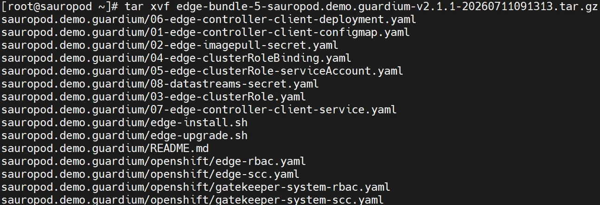{ width="99%" }

1.	After a short while, you should observe a deployment started and **edge-manager** pod will appear on the pod list (copy *pod name* for next command).
```bash
kubectl get pods -A
```
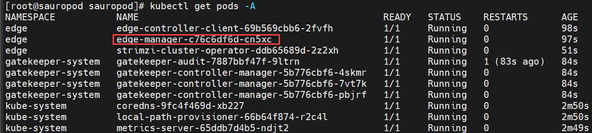{ width="99%" }

 
1.	After few minutes the *Edge Gateway* deployment should finish with success. Execute this loop to confirm it (provide your **edge-manager** pod name). 
```bash
while true; do LINE=$(kubectl logs <edge_manager_pod_name> -n edge | grep "EDGE_SERVICES_INSTALLATION_STATUS is Completed" | tail -n 1); [ -n "$LINE" ] && echo "$LINE" && break; sleep 5; done
```
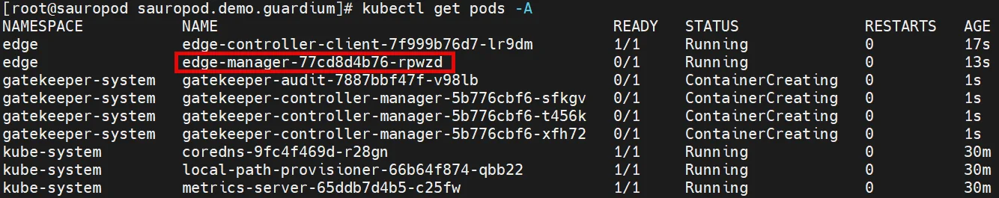{ width="99%" }
 
1.	Open the **Central Manager** view in the **cm** UI and confirm the status change for **sauropod** *Edge Gateway*. A green checkmark should now appear, confirming that communication is working correctly.
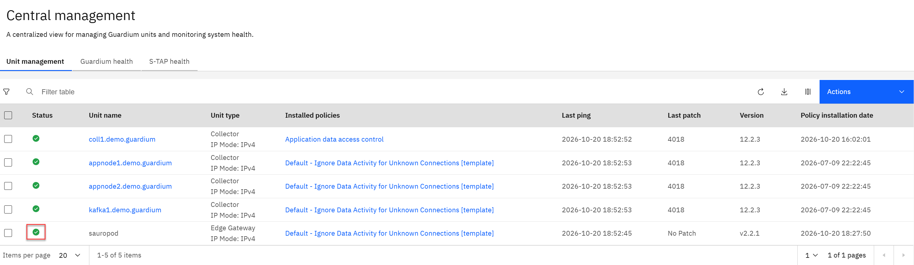{ width="99%" }
 
1.	In the **cm** UI, create a new dashboard and name it - *Edge Gateway*. Then, add the following four reports:

    !!! note ""
        - Edge Buff Usage Monitor
        - Edge Extraction Log
        - Edge Live Full SQL
        - Edge Live Session List

    Even though you are not sending any events to the *Edge Gateway* yet, the *Edge Buff Usage Monitor* report should show sniffer statistics generated every minute.

    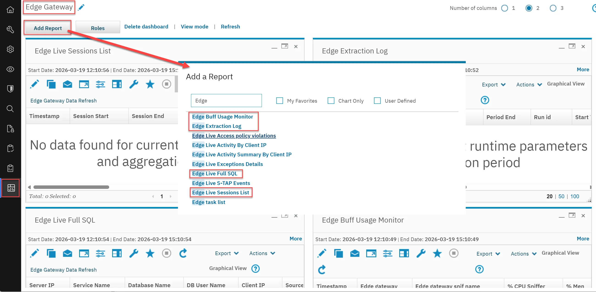{ width="99%" }
 
1.	The next step is to set the policy. In the **cm** UI, open the *Security Policies* view. Select the *Log Everything* policy, and then select the **Install** option from the dropdown list. In the window that appears, select just deployed *Edge Gateway* and the **Install and Override** option. The execution of the change will be confirmed by an additional message.
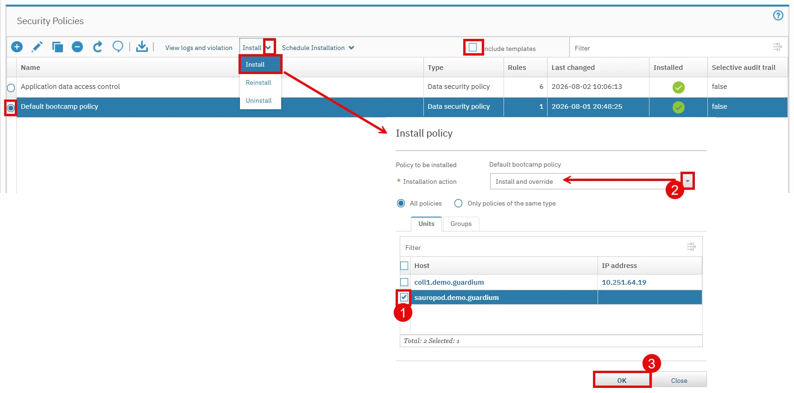{ width="99%" }
 
1.	In the **Central Management** view, information about the installation of the new policy should appear.
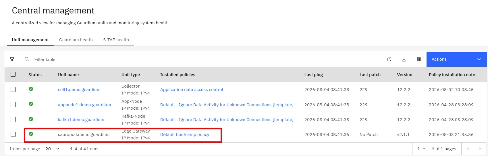{ width="99%" } 


## Send traffic from STAP to Edge Gateway

1.	In the **Central Management** view, select the *Edge Gateway*. This will display a list of ports where the service is listening for specific traffic types. These ports are randomly assigned from the *NodePorts* pool for each *Edge Gateway* instance. Make a note of both ports assigned to *Windows S-TAP*, as you will need them for the next configuration step.
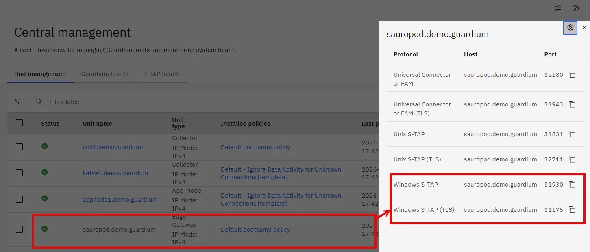{ width="99%" }
 
1.	On **cm** open the **Setup by Client** view and select the **ceratops.demo.guardium** client. Then, choose the currently installed **S-TAP** version - **12.2_r120202259_1** - and change the values:

    !!! note ""
        - WINSTAP_USING_EDGE: 1
        - WINSTAP_SQLGUARD_IP: sauropod.demo.guardium
        - WINSTAP_SQLGUARD_PORT: &lt;node port identified in point 1 as a *Windows S-TAP*>
        - WINSTAP_SQLGUARD_TLS_PORT &lt;node port identified in point 1 as a *Windows S-TAP (TLS)*>

    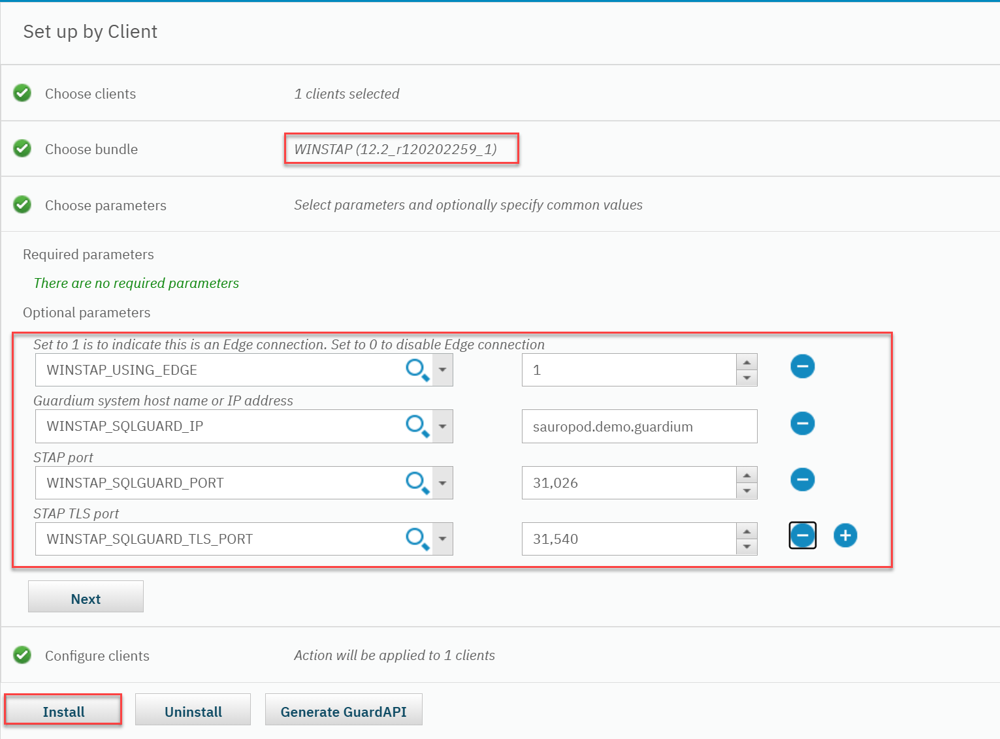{ width="99%" }

1.	Confirm the change by monitoring the status of the task.
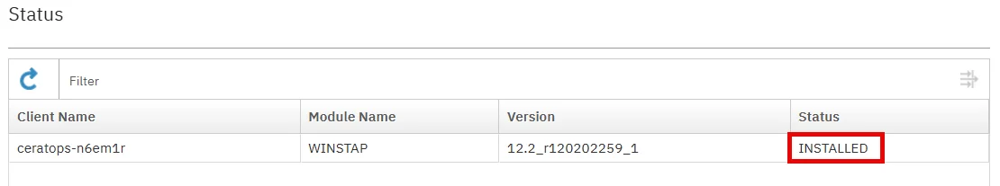{ width="99%" }
 
1.	In the *Edge Buff Usage Monitor* report (in the *Edge Gateway* dashboard), the **Analyzer Total** value should begin to change, indicating the number of events analyzed by the sniffer.
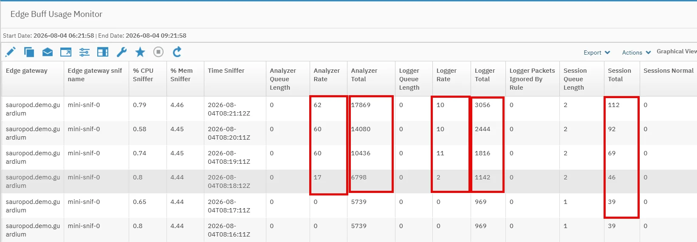{ width="99%" } 
 
1.	Reports with *Edge Live* in their name provide a new functionality that allows you to download a fragment of the data currently being processed on the *Edge Gateway*. This confirms the correct operation of policies without having to wait for the full cycle on the aggregator side. The report is equipped with an additional *Edge Gateway Data Refresh* option, which enables sending a request to the sniffer. Use this option in the *Edge Live Session List* report.
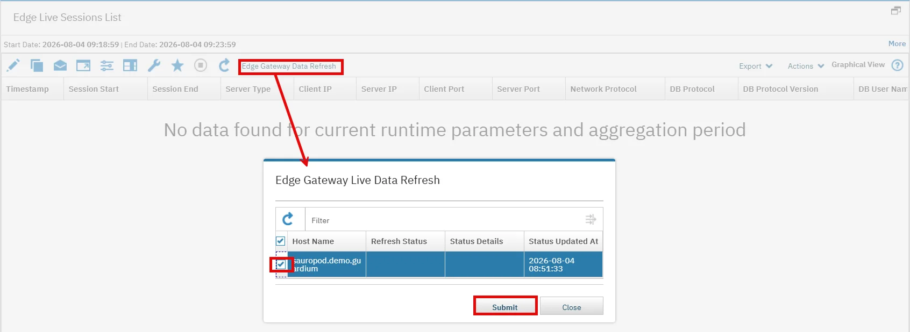{ width="99%" } 
 
1.	After a moment, use the new option again to confirm that the data has been transmitted. 
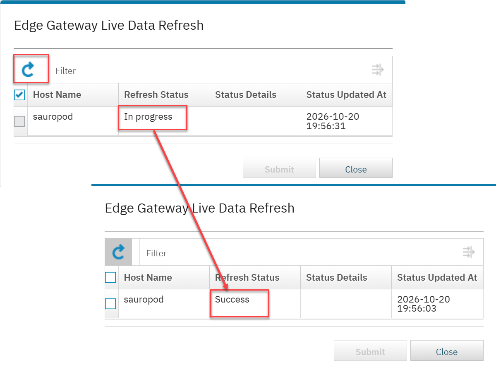{ width="69%" } 
 
1.	Refresh the report and ensure that the data is flowing to the *Edge Gateway* and is being properly audited according to the installed policy.
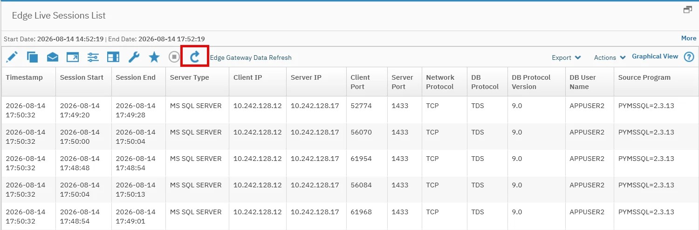{ width="99%" } 
 
1.	You can also check the *Edge Live Full SQL* report and notice that SQL’s are logged correctly.
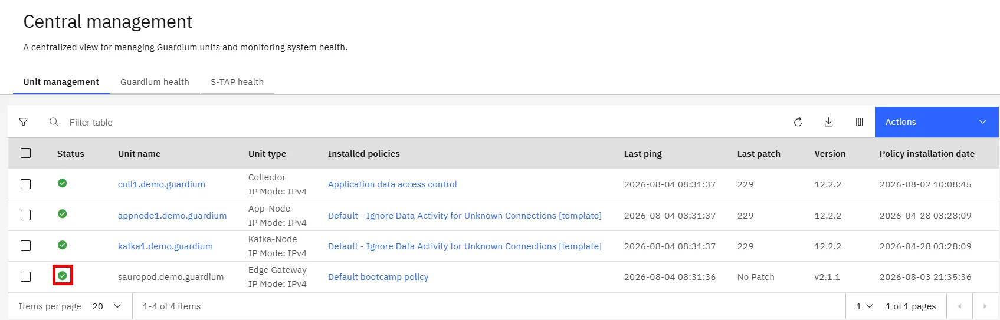{ width="99%" } 

<!-- 1.	By default, data is synchronized with the aggregator every hour. Depending on the volume of events, this process can be delayed or accelerated. In our laboratory environment, we can change this value to 10 minutes. To do this, select the *Edge Gateway* in the **Central management** view and select the **Edit edge parameters** option from the context menu.
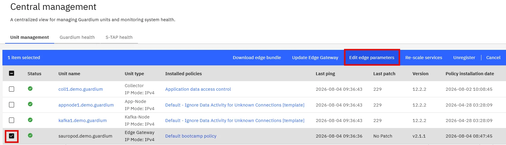{ width="99%" } 
 
1.	In the *Configure edge gateway parameters* window, expand the Environments list, which allows for editing individual service parameters. Select data-manager and change the value of the DB_ROTATE_INTERVAL parameter from 3600 to 600, then confirm the change – Update parameters.  
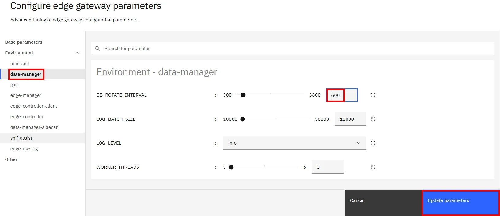{ width="99%" }  -->

1.	Data from *Edge Gateway* are offloaded to aggregator (our **cm** in this case) on an hour basis. Open the standard *Full SQL (Training)* report in the **Training** dashboard and confirm that the data is indeed refreshed according to this schedule (you must have *Edge Gateway* running minimum 2 hours to observe offload period).
{ width="99%" } 

## Appendix

!!! note "Dependencies:"

!!! note "Resources:"
    
!!! note "Instructor notes:"