# MCP in Guardium

## Setup Gen AI node

1. This lab assumes that you have IBM Bob installed on your workstation. If you do not plan configure MCP server with IBM Bob follow only current chapter to deploy Gen AI node.

1.	Login to **appnode2** as a **cli** user and switch appliance type to `appnode` and confirm (*y*) its reboot
```bash
store unit type app-node
```
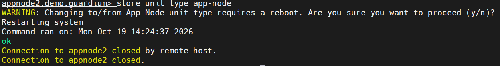{ width="99%" }

1.	After a short wait, sign in to **appnode2** again and confirm that the appliance is now operating in *App-Node* mode.
```bash
show unit type
```
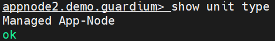{ width="49%" }

1.	The next step is to install the *GenAI* extension on the **appnode2**. The extension is delivered as a special patch located in one of the directories on **raptor**. From the **cli** session on **appnode2**, run the installation command and provide the following parameters:

    !!! note ""
        - Host: **raptor.demo.guardium**
        - User: **root**
        - File parth: **/opt/guardium_tz_bootcamp_automation/upload/source_files/appliances/extensions/SqlGuard-12.0p80020_genai_Jun_22_2026.tgz.enc.sig**
        - Port: **2223**
        - Password: **&lt;default service password>**

    ```bash
    store system patch install scp
    ```

    After a short time, the file should be downloaded and appear in the list of available patches. Select it and wait for confirmation that the installation procedure has started.

    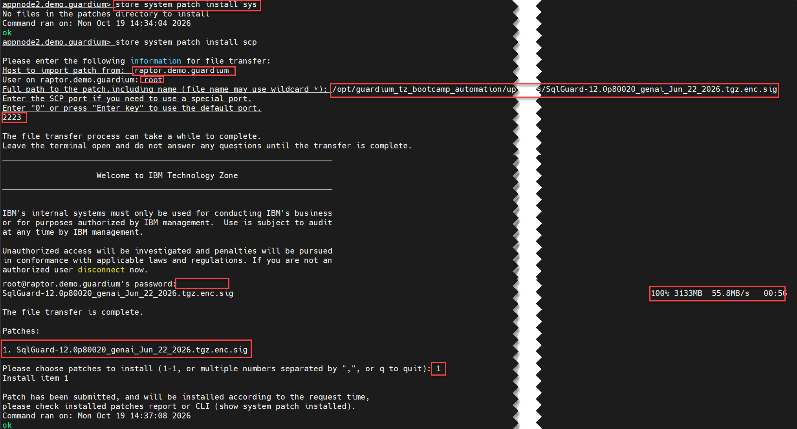{ width="99%" }

1.	Monitor the installation status every few minutes until you can confirm that patch **80020** has been successfully applied.
```bash
show system patch install
```
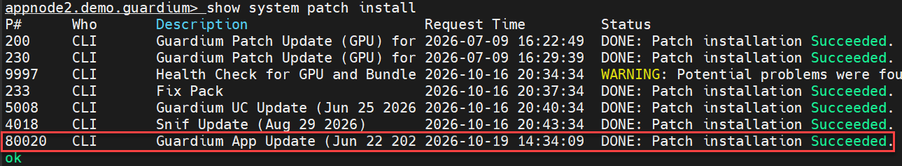{ width="99%" }

1.  Communication with the *MCP* server running on your appliance will take place through the *REST API*. To enable this communication, you must generate a dedicated *API* key. While still logged in to **appnode2**, run the following command and save the generated key, it will be required in the next steps of the lab.
```bash
grdapi create_api_key name=gdp_mcp
```
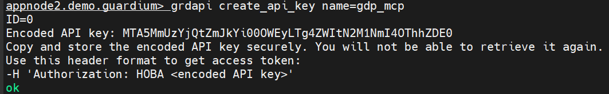{ width="99%" }

## Prepare your Windows workstation to use MCP

1. First, you must trust the certificate used by the *MCP* server. To do this, first download the certificate and then add it to the list of trusted certificates. 
 
1. If your workstation is running **Windows**, open a new **PowerShell** session in Administrator mode. You can do that from standard PowerShell session:
```powershell
Start-Process powershell -Verb RunAs
```

1. Then navigate to the directory where you want to save the certificate and execute the commands below. For the first command, make sure to replace the placeholder with the correct *public IP* address of **appnode2**.
```powershell linenums="1"
$site="<your_appnode2_public_ip_address>"

[Net.ServicePointManager]::ServerCertificateValidationCallback={$true};$r=[System.Net.WebRequest]::Create("https://$site`:8443/");$r.GetResponse()|Out-Null;$c=New-Object System.Security.Cryptography.X509Certificates.X509Certificate2($r.ServicePoint.Certificate);[IO.File]::WriteAllBytes("$PWD\appnode2.cer",$c.Export([System.Security.Cryptography.X509Certificates.X509ContentType]::Cert))
```
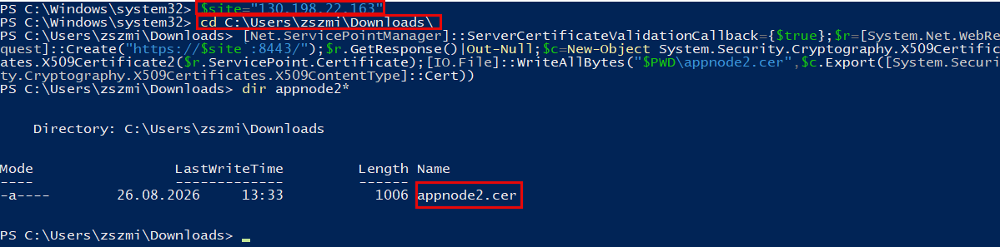{ width="99%" }

1.	Add the newly exported `appnode2.cert` certificate to the list of trusted *Certificate Authorities (CAs)*. You will need to confirm the operation in the pop-up window that appears.
```powershell
Import-Certificate -FilePath ".\appnode2.cer" -CertStoreLocation Cert:\CurrentUser\Root -Confirm:$false
```
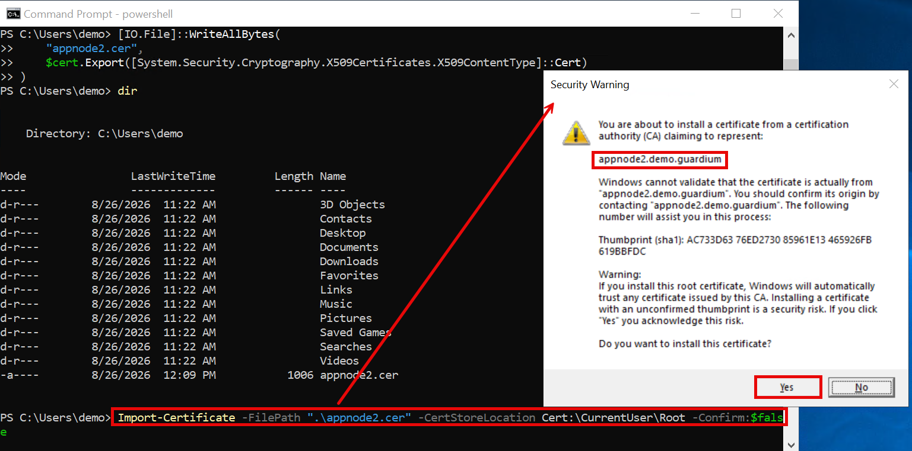{ width="99%" }

1.	Verify that the certificate was imported successfully by opening *Certificate Manager* and confirming that the `appnode2.demo.guardium` certificate is present under *Trusted Root Certification Authorities → Certificates*.
```cmd
certmgr.msc
```
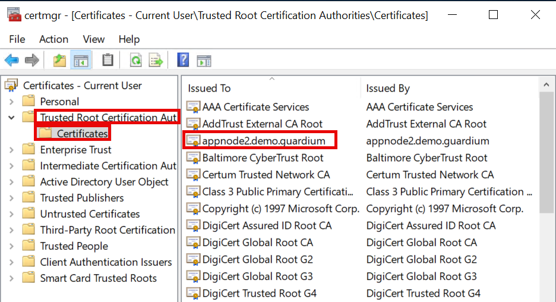{ width="79%" }

1.	You must also ensure that the *appnode2.demo.guardium* hostname resolves correctly. Add a host entry using the local hosts file and verify that name resolution is working properly.
```powershell linenums="1"
Add-Content -Path "$env:SystemRoot\System32\drivers\etc\hosts" -Value "`n$site appnode2.demo.guardium"

ipconfig /flushdns

ping appnode2.demo.guardium
``` 
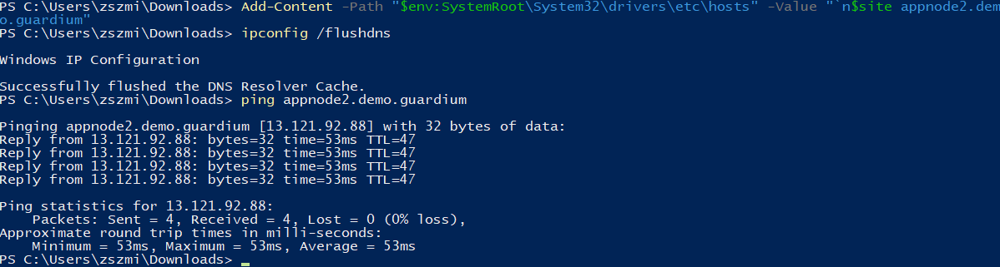{ width="99%" }

## Configure the MCP server in IBM Bob

1. Open *IBM Bob* and open its settings <span class="mb">1</span>, then select MCP <span class="mb">2</span>. In the top row of MCP server list select ++plus++ icon to add new MCP server definition.
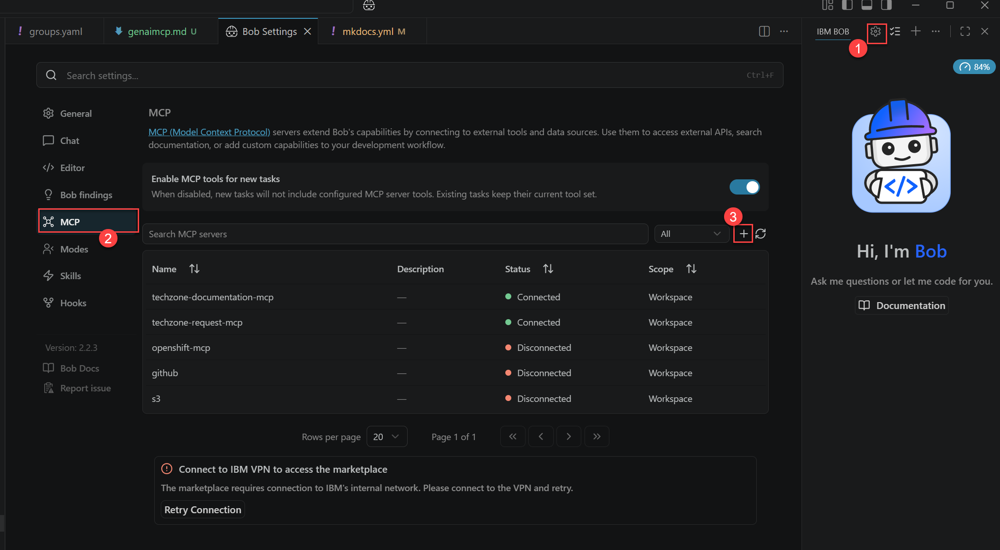{ width="99%" }

1.  In the window that appears, select **Global** as the *Configure Scope*, then click **Open Configuration File**.
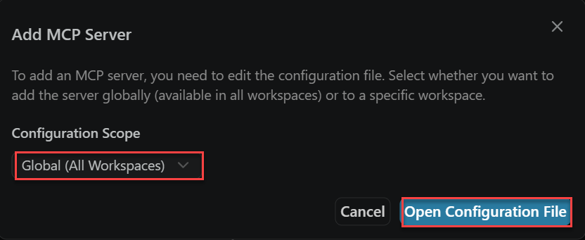{ width="89%" }

1.  In the editor, enter the following content in `mcp.json`, replacing the *API key* with the one generated during the *GenAI* node initialization.
```json
{
  "mcpServers": {
    "gdp-mcp": {
      "type": "streamable-http",
      "url": "https://<your_gdp_appnode_URL>/mcp",
      "headers": {
        "Authorization": "Bearer <your_gdp_api_key>",
        "x-mcp-enable-discovery": "true"
      },
      "disabled": false,
      "alwaysAllow": [],
      "timeout": 120000
    }
  }
}

```
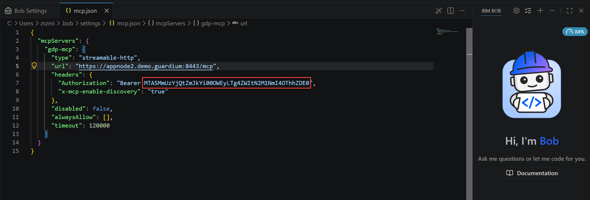{ width="99%" }

1.  Return to the *Bob Settings* tab. The **gdp-mcp** definition should now appear with the status *Connected*. You can use the refresh icon :material-refresh: to check the connection status again.
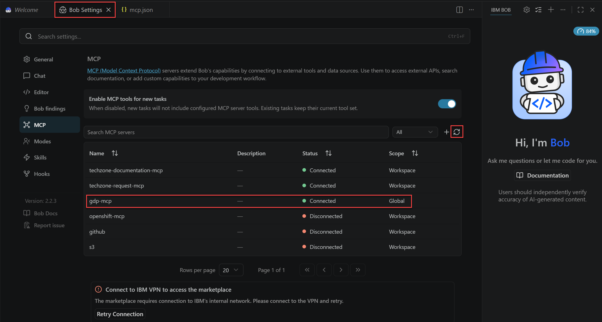{ width="99%" }

1.  Select the newly added server to display information about the service and several configuration parameters for the tools provided by the *MCP* server.
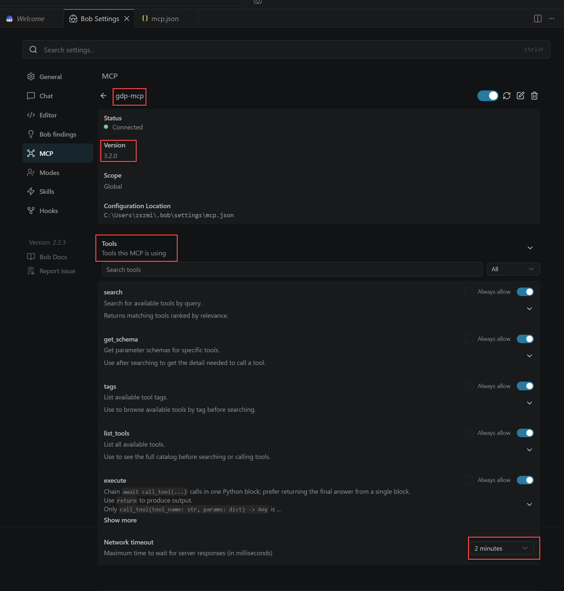{ width="99%" }

1.  Open a new task in *IBM Bob* and start using the *MCP* server you just configured. Below are a few example prompts you can try:
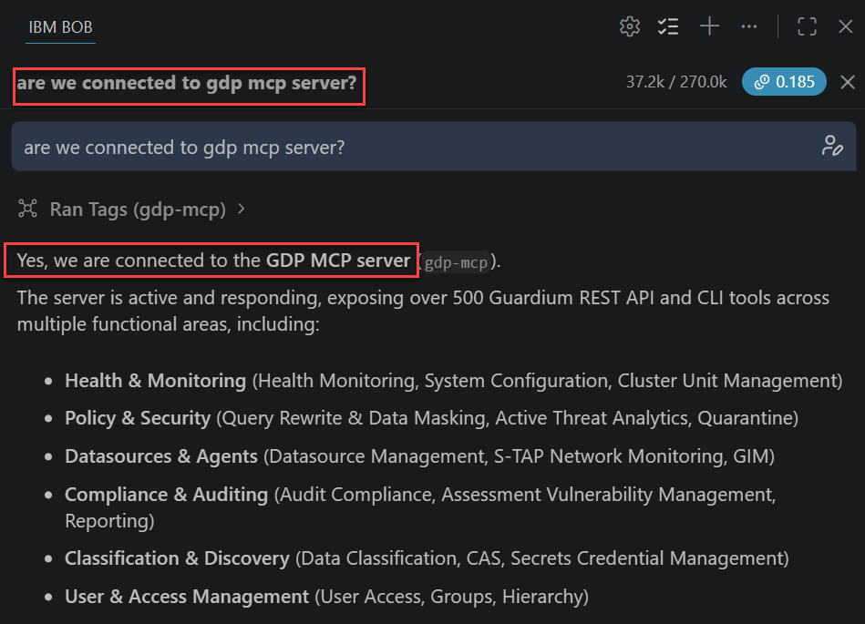{ width="99%" }
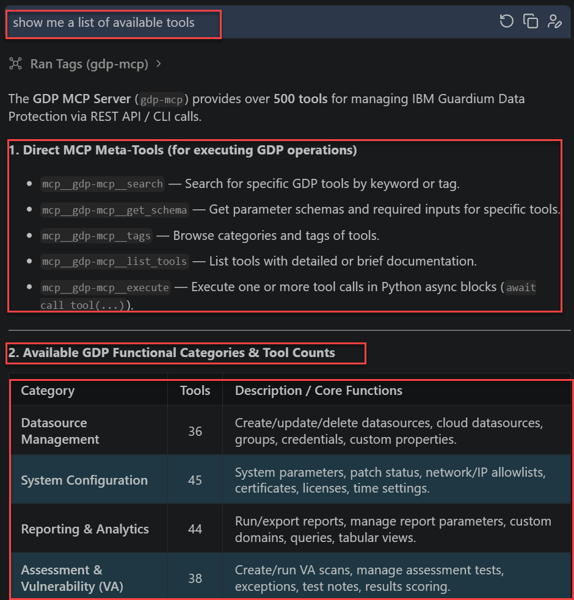{ width="99%" }
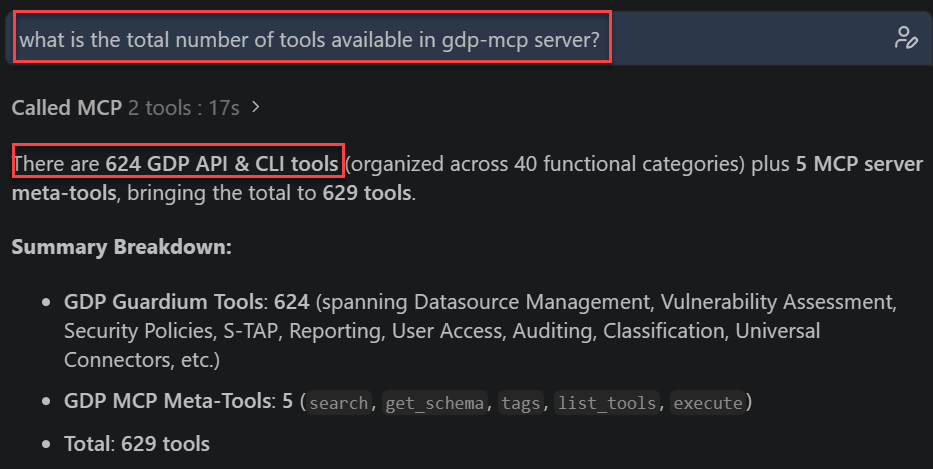{ width="99%" }
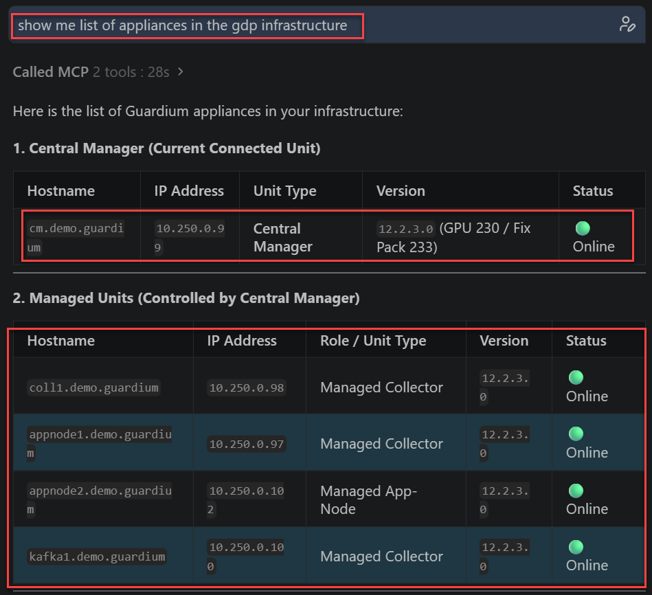{ width="99%" }

## Configure the MCP server in Antigravity

1. There is an assumption that you have installed **Antigravity** application on your workstation.

1. Edit `.gemini\config\mcp_config.json` in your home directory and insert *MCP* server configuration. If file is empty insert this content (use your *API key* value):
```json
{
  "mcpServers": {
    "gdp-mcp": {
      "serverUrl": "https://appnode2.demo.guardium:8443/mcp",
      "headers": {
        "Authorization": "Bearer <your API key generated at the lab beginning>",
        "x-mcp-enable-discovery": "true"
      }
    }
  }
}
```
If you have other *MCP* servers defined, add our one by inserting addition member of *mcpServers* object:
```json
    "gdp-mcp": {
      "serverUrl": "https://appnode2.demo.guardium:8443/mcp",
      "headers": {
        "Authorization": "Bearer <your API key generated at the lab beginning>",
        "x-mcp-enable-discovery": "true"
      }
    }
```

1. Then restart Antigravity application. Select **Customization**, just above *conversation* list. Switch to Installed list abd notice our **gdp-mcp** server appearance in the *MCP Servers* section and its green status.
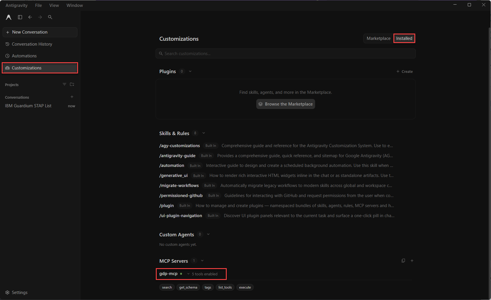{ width="99%" }

1. Open new conversation and start asking about **GDP** environment (confirm usage of *MCP* server).
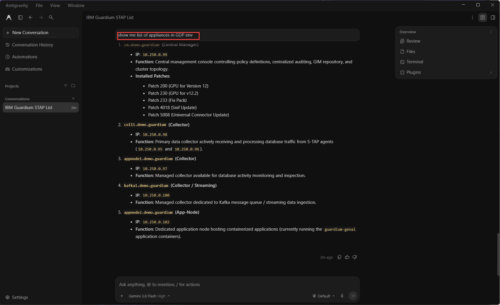{ width="99%" }

## Appendix

!!! note "Dependencies:"

!!! note "Resources:"
    
!!! note "Instructor notes:"