# Universal connector 1.0 - logstash based
	
## Cassandra configuration check

1.	On **sauropod** machine as a **root** confirm that *Cassandra* cluster is up.
```bash
nodetool status
```
[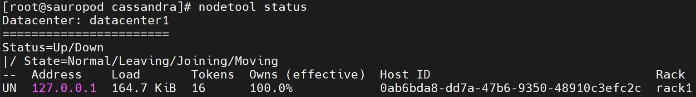{ width="99%" }](../images/logstash1.webp)

 
1.	Confirm that `audit.log` file appeared in `/var/log/cassandra/audit/`.
```bash
ls /var/log/cassandra/audit/audit.log
```
[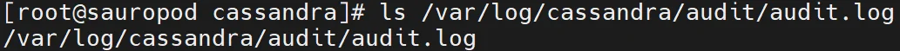{ width="99%" }](../images/logstash2.webp)

1.	Login to *Cassandra* on **sauropod** and generate some events.
```sql linenums="1"
cqlsh

CREATE KEYSPACE movies WITH REPLICATION = { 'class' : 'SimpleStrategy',     'replication_factor' : 1 };

use movies;

CREATE TABLE movie (id UUID PRIMARY KEY, m_title text, m_release int);

INSERT INTO movie (id, m_title, m_release) VALUES (uuid(), 'Alien', 1979);

select * from movie;

exit
```

1.	Check audit log to confirm that events are stored in.
```bash
cat /var/log/cassandra/audit/audit.log
```
[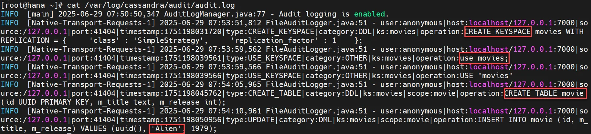{ width="99%" }](../images/logstash3.webp)

## Filebeat installation and setup

1.	Check the latest version of `filebeat` on *Elastic* web page - <https://www.elastic.co/downloads/beats/filebeat> 
[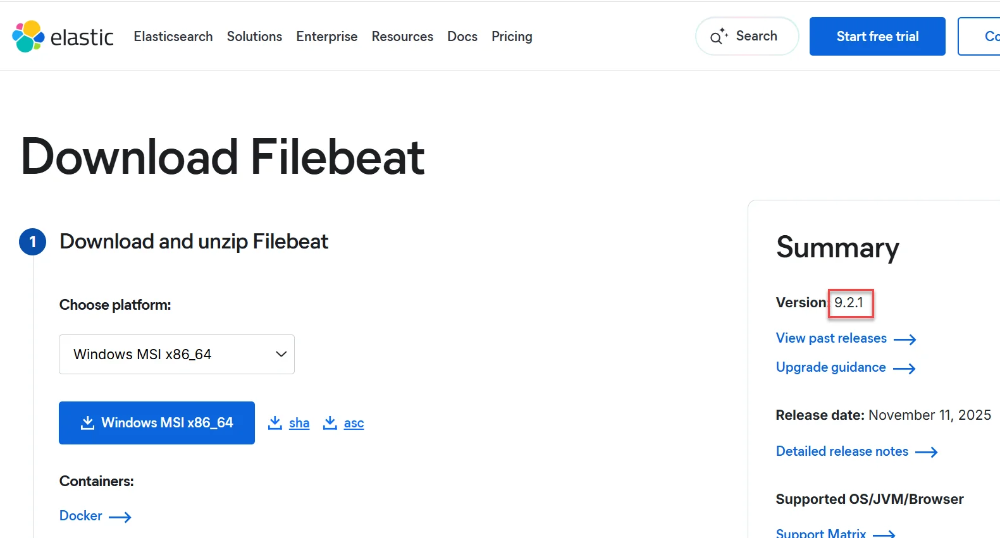{ width="99%" }](../images/logstash4.webp)
 
1.	Download the `filebeat` rpm (replace *filebeat_version* variable to the latest one) - on sauropod machine:
```bash linenums="1"
mkdir -p /root/lab_files

cd /root/lab_files

curl -L -O https://artifacts.elastic.co/downloads/beats/filebeat/filebeat-<filebeat_version>-x86_64.rpm
```

1.	Install `filebeat`.
```bash
dnf -y install /root/lab_files/filebeat-<filebeat_version>-x86_64.rpm
```

4.	Edit `/etc/filebeat/filebeat.yml`. Modify *filebeat.inputs* section to form below (use spaces in the indendation, it is *YAML* file, format is indentation aware!):
```yaml
- type: filestream
  id: "cassandra"
  enabled: true
  paths:
      - /var/log/cassandra/audit/audit.log
  exclude_lines: ['AuditLogManager']
  tags: ["cassandra"]
  multiline.type: pattern
  multiline.pattern: '^INFO'
  multiline.negate: true
  multiline.match: after
``` 
[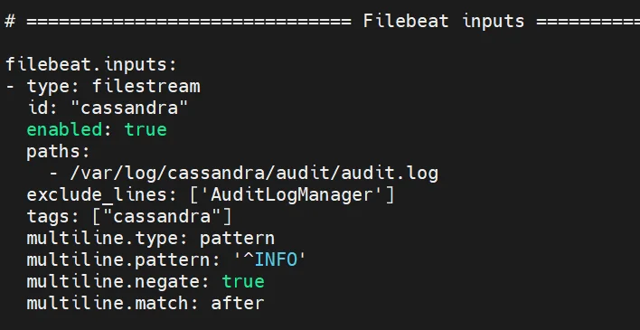{ width="69%" }](../images/logstash5.webp)
<BR>Comment or remove the entire section *output.elasticsearch*<BR>
[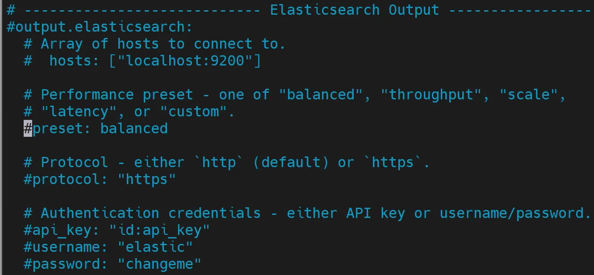{ width="79%" }](../images/logstash6.webp)
<BR>Modify *output.logstash* section to form below, it is important to use **coll1.demo.guardium** name because we will later set the encrypted connection between `filebeat` and **coll1**. Do not forget to uncomment *output.logstash* section row as well.
```yaml
# ------------------------------ Logstash Output ---------------------------
output.logstash:
  # The Logstash hosts
  hosts: ["coll1.gdemo.com:5047"]
```
[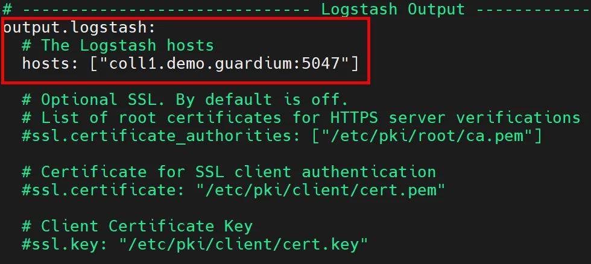{ width="69%" }](../images/logstash7.webp)

1.	Start *filebat* on **sauropod**.
```bash linenums="1"
systemctl start filebeat

systemctl status filebeat

systemctl enable filebeat
```

## Configure UC plugin

1. Login to **cm** UI nad open the **Datasource Profile Management** view and click the :material-plus: icon to create a new *Universal Connector* profile. Select the *Cassandra* plug-in from the list. This will display additional configuration options.

    !!! node "parameters:"
        - Name: **cassandra on sauropod**
        - Description: **logstash based cassandra UC**
        - Plug-in: **Cassandra Over Filebeat**
        - Datasource Tag: **cassandra** (must correspond to ID defined in `filebeat.yml`)
        - Port: **5047** (must correspond to port defined in `filebeat.yml`)
        - Include codec tag: :material-check:

    Click OK. A dialog box will appear indicating that the configuration is being saved. Wait for the operation to complete and confirm the message when prompted.
    
    [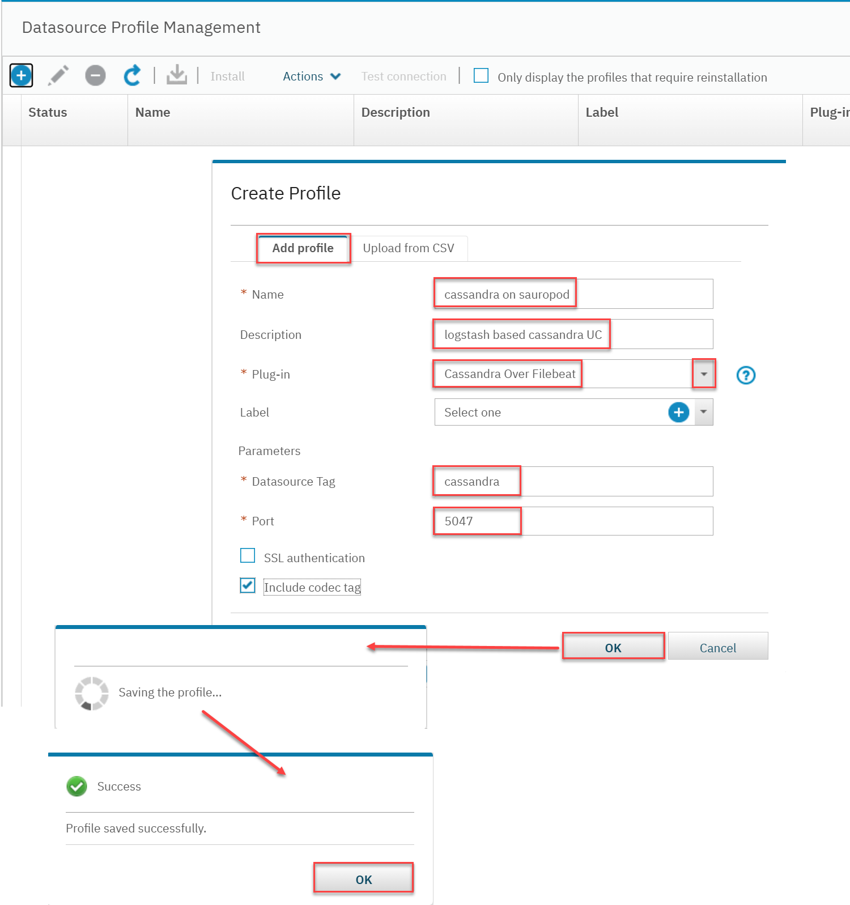{ width="99%" }](../images/logstash8.webp)

1. The newly created *Universal Connector* profile should now appear in the list. To deploy it to a collector, select the profile and choose **Install** from the **Install** menu. In the *Install Profile* window, select **coll1.demo.guardium** as the target collector and click **Run Now** to start the deployment.
[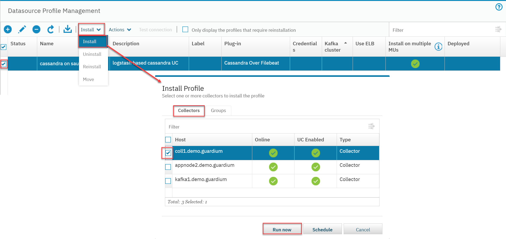{ width="99%" }](../images/logstash9.webp)

1. After returning to the main **Datasource Profile Management** view, a progress indicator :material-sync: should appear in the **Deployed** column. Refresh the view periodically :material-reload: until the deployment completes and a confirmation is displayed indicating that the *Universal Connector* has been successfully configured on the collector.
[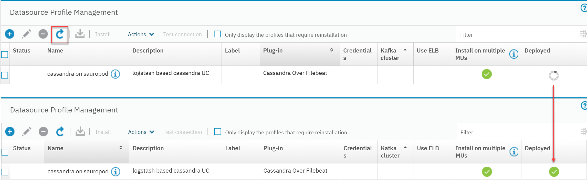{ width="99%" }](../images/logstash10.webp)

1.	Open **S-TAP Status** view in **coll1** UI. You should see a new *Cassandra* universal connector instance listed. If the status will be *Inactive* it means that there is no currently traffic processes but our configuration but universal connector is set correctly.
[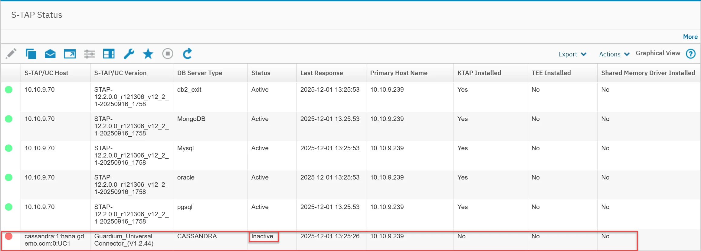{ width="99%" }](../images/logstash16.webp)

## Check traffic visibility

1.	Execute some activity in *Cassandra* instance on *sauropod*.
```sql linenums="1"
cqlsh

use movies;

INSERT INTO movie (id, m_title, m_release) VALUES (uuid(), 'Aliens', 1986);

INSERT INTO movie (id, m_title, m_release) VALUES (uuid(), 'Alien 3', 1992);

INSERT INTO movie (id, m_title, m_release) VALUES (uuid(), 'Alien: Resurrection', 1997);

INSERT INTO movie (id, m_title, m_release) VALUES (uuid(), 'Alien: Romulus', 2024);

INSERT INTO movie (id, m_title, m_release) VALUES (uuid(), 'Alien: Earth', 2025);

select * from movie;

exit;
```
[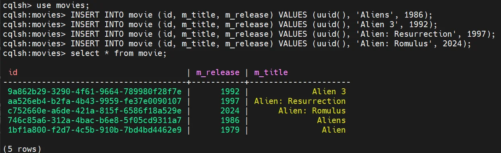{ width="99%" }](../images/logstash17.webp)
 
1.	Check *Full SQL (Training)* report on **coll1**.
[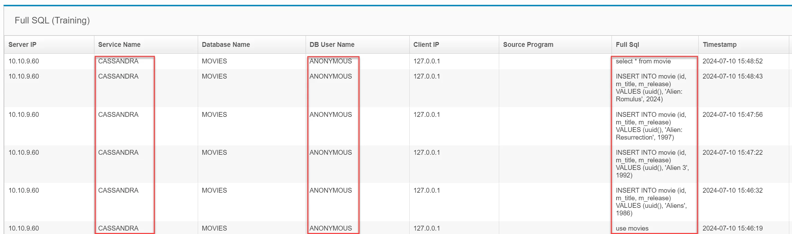{ width="99%" }](../images/logstash18.webp)
 
1.	In the **coll1** UI open **S-TAP Status** view. Just installed universal connector instance should be now *Active*. 
[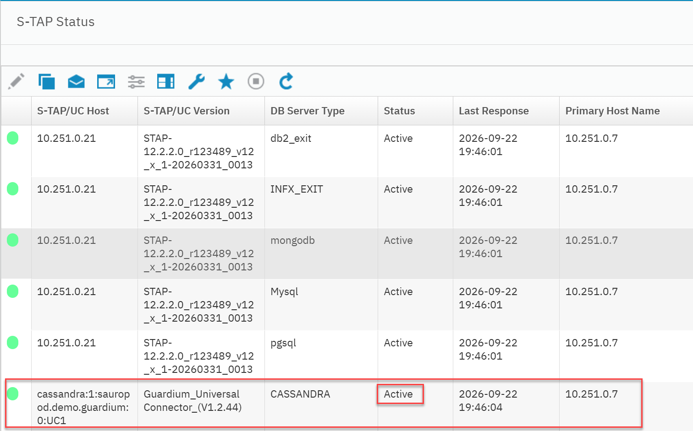{ width="99%" }](../images/logstash19.webp)

## Set TLS connection between filebeat and logstash (optional)

1.	On **coll1** as a **cli** user regenerate self-signed certificate for universal connector and copy public certificate to buffer (domain is **demo.guardium**)
```bash
grdapi generate_ssl_key_universal_connector overwrite=1 hostname=*.demo.guardium
```
[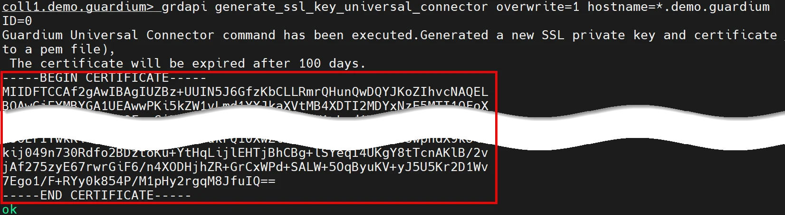{ width="99%" }](../images/logstash20.webp)
 
1.	Save just created above certificate into the file `/etc/filebeat/guardium.pem` on **sauropod** machine.<BR>
[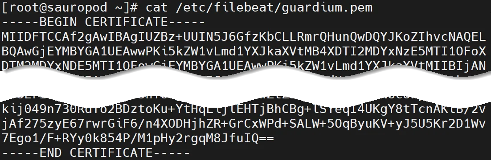{ width="79%" }](../images/logstash21.webp) 

1.	Check *logstash* TLS support on the **coll1** by checking the server port and notice that TLS is not available.
```bash
openssl s_client -connect coll1.demo.guardium:5047
```
[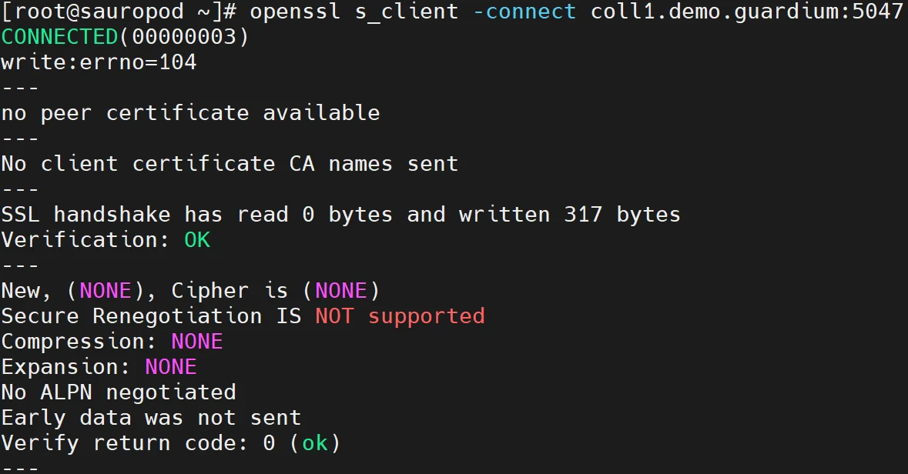{ width="79%" }](../images/logstash22.webp) 

1.	In **cm** UI and edit :material-pencil: *universal connector* instance definition (**Datasource Profile Management** view). Select **SSL authentication** flag :material-check: and save change - **OK** button.
[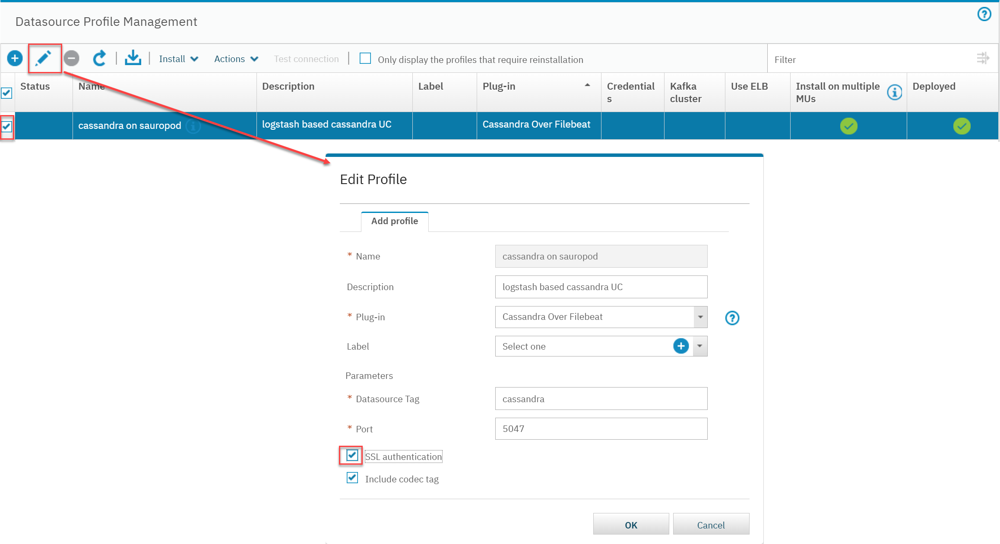{ width="99%" }](../images/logstash11.webp) 

1. Po chwili zmiany zostaną zapisane ale nie zdeployowane, co widoczne będzie ikoną :material-alert-outline: przy nazwie UC.
[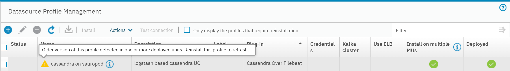{ width="99%" }](../images/logstash12.webp) 

1. To reinstall the *Universal Connector* on the **coll1**, select the profile and choose **Reinstall** from the **Install** menu. You will be prompted to confirm the operation and then specify when the reinstall should be performed. Select **Run Now**.
  After a short time, you will be returned to the main **Datasource Profile Management** view. As with the initial deployment, wait for the operation to complete and refresh the view periodically until the status confirms that the reinstall has been successfully applied.
  [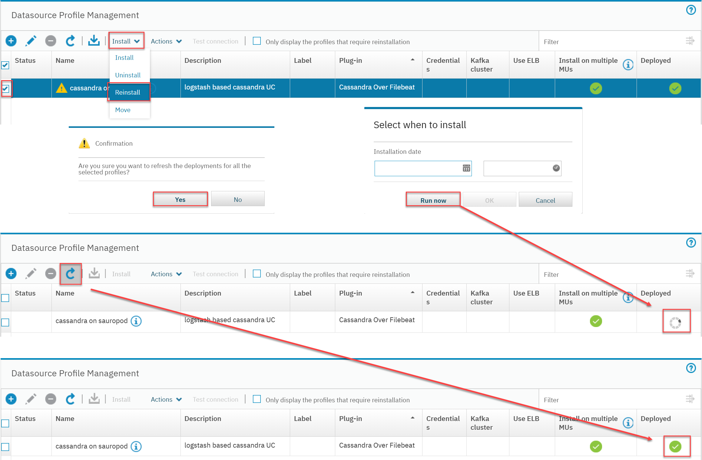{ width="99%" }](../images/logstash13.webp) 

1.	Check TLS *logstash* readiness on **coll1** from **sauropod** machine
```bash
openssl s_client -connect coll1.demo.guardium:5047 < /dev/null
```
[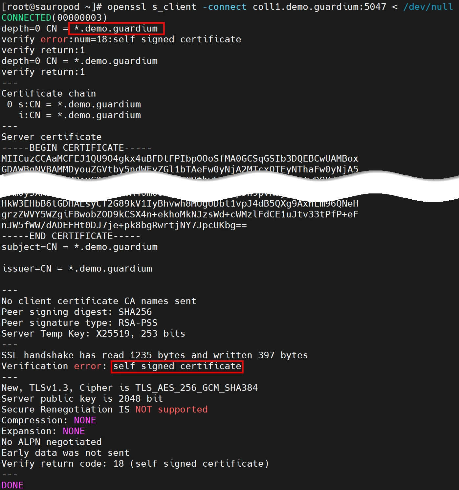{ width="89%" }](../images/logstash24.webp) 

1.	Modify *output.logstash* section in `/etc/filebeat/filebeat.yml` store on **sauropod** machine by enabling *ssl.certificate_authorities* parameter with path to file cert file created in point 2 (`/etc/filebeat/guardium.pem`) and *ssl.verification_mode set* to **none** because a temporary bug with cert generation in point 1.
```yaml
output.logstash:
  # The Logstash hosts
  hosts: ["coll1.demo.guardium:5047"]

  # Optional SSL. By default is off.
  # List of root certificates for HTTPS server verifications
  ssl.certificate_authorities: ["/etc/filebeat/guardium.pem"]
  ssl.verification_mode: none
```
[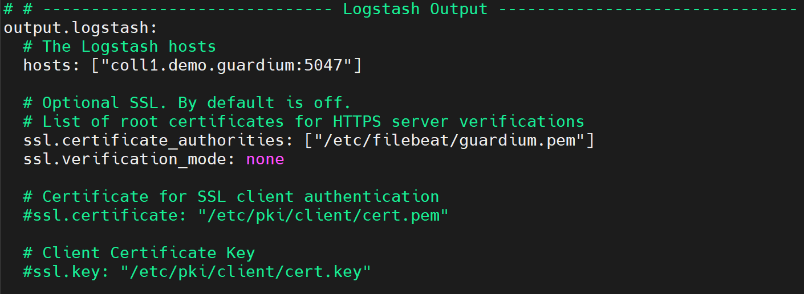{ width="75%" }](../images/logstash25.webp)  

1.	Restart filebeat service on sauropod machine
```bash linenums="1"
systemctl restart filebeat

systemctl status filebeat
```

1.	Execute again some SQL’s
```sql linenums="1"
cqlsh

use movies;

SELECT * FROM movie;

select * from movie where m_release > 2000 ALLOW FILTERING;

exit;
```
[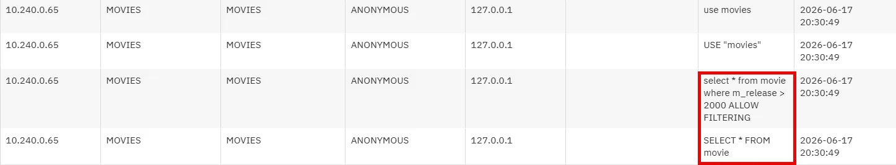{ width="99%" }](../images/logstash26.webp) 

## Appendix

!!! note "Dependencies:"
    If your goal is not related to practicing universal connectors based on *logstash*, you may skip this lab, with the understanding that some of the other labs may refer to a non existent instance of the Cassandra universal connector in your environment.
    I suggest do not deploy *logstash* and later kafka based traffic to **coll1**, so do not join these two labs one after another.

!!! note "Resources:"
    - Universal Connector documentation <https://www.ibm.com/docs/en/guardium/12.x?topic=guardium-universal-connector>
    - Filebeat logstash output documentation <https://www.elastic.co/guide/en/beats/filebeat/current/logstash-output.html>
    - Available UC plugins <https://github.com/IBM/universal-connectors/blob/main/docs/available_plugins.md>
    - Cassandra audit logging configuration <https://cassandra.apache.org/doc/stable/cassandra/operating/audit_logging.html#view-the-contents-of-auditlog-files>
    
!!! note "Instructor notes:"
