# VA result sets processing

## Understand VA report

1.  In **cm** UI, open the **Security Assessment Builder** view and run an existing scan for the *PostgreSQL* database.

    [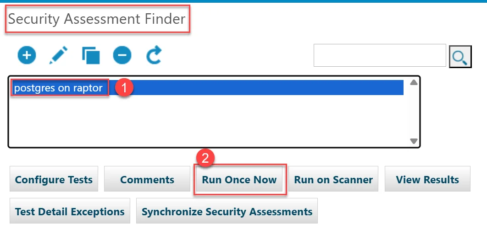{ width="69%" }](../images/varesults1.webp) 

1.	In the **Guardium Job Queue** view, confirm that the vulnerability assessment process has been completed.
    [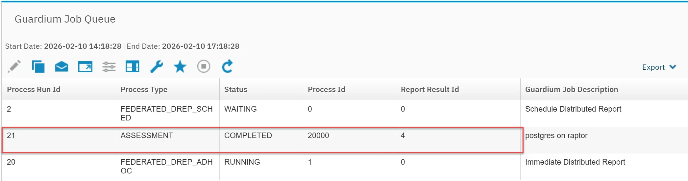{ width="99%" }](../images/varesults2.webp) 

1.	Return to the **Security Assessment Builder** view and select the existing vulnerability assessment process definition for *PostgreSQL*. Then, use the **View Result** button, which should open a pop-up window with the report. It may turn out that your browser is blocking pop-up windows for this site. In that case, allow the exception for the **cm** UI.
[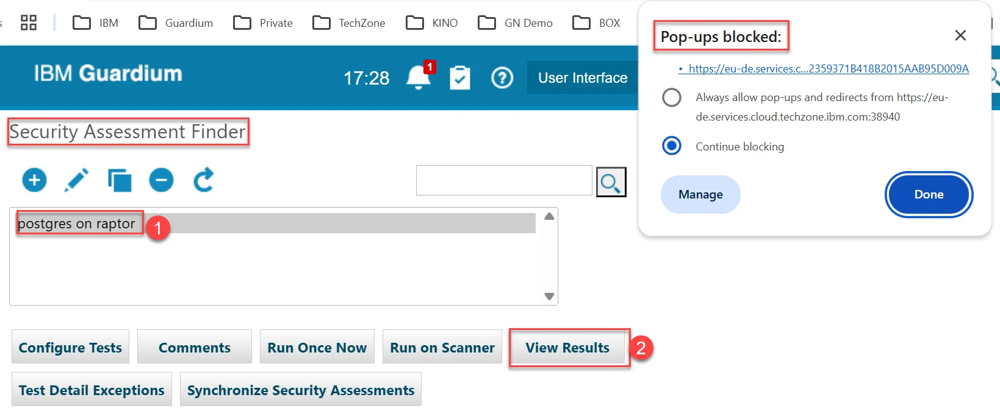{ width="99%" }](../images/varesults3.webp)

1.	The main part of the report presents the *Assessment Test Results*. It contains detailed information about each test included in the assessment process together with its corresponding test score. If the requirements for a specific test are not met and the result is marked as failed, the report also provides a recommendation for administrators describing how the identified vulnerability can be remediated.
In practice, many tests generate a large number of violations, which makes manual vulnerability management inefficient and difficult to scale. For this reason, many organizations implement customized remediation workflows tailored to their operational needs, often using platforms such as ServiceNow to track, prioritize, and resolve discovered issues.

    Another challenge is that vulnerability data is typically sourced from multiple systems. For example, **Guardium** may be used to assess data engines, **Tenable** to scan infrastructure components, and **Qualys** to cover additional environments. To consolidate and manage this information effectively, *Vulnerability Assessment* systems must be integrated using *API*s. In this context, **Guardium** acts as a data provider whose results need to be programmatically consumed and processed by an external system. In this hands-on lab, we will focus on preparing such an integration and working with **Guardium** assessment data through an API-based approach.

    [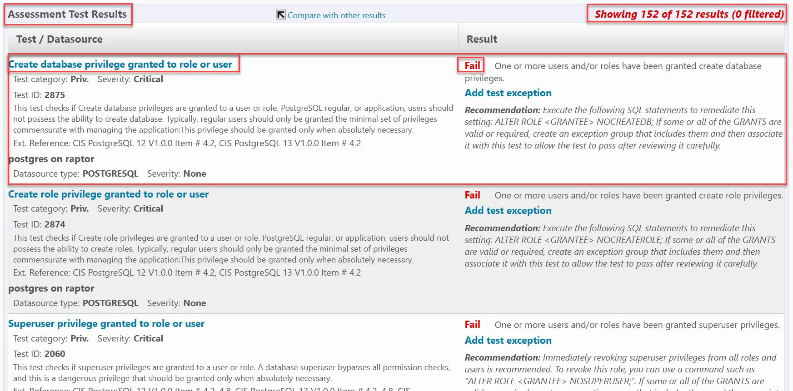{ width="99%" }](../images/varesults4.webp)
 
1.	After logging into the **cli** session on **cm**, we can observe two interesting *API* calls.
```bash
grdapi commands assessment
```
[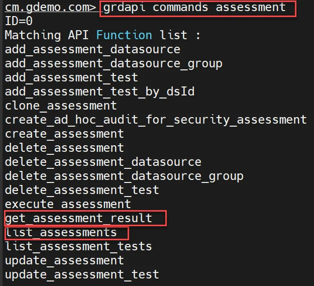{ width="49%" }](../images/varesults5.webp)

1.	The `grdapi list_assessments` command unfortunately displays only a list of existing configurations, while `grdapi get_assessment_result` provides only a brief summary of the last run. This information is definitely not sufficient to properly supply an external system with detailed results of individual tests.
```bash linenums="1"
grdapi list_assessments

grdapi get_assessment_result assessmentDescription="<assessment_name>"
```
[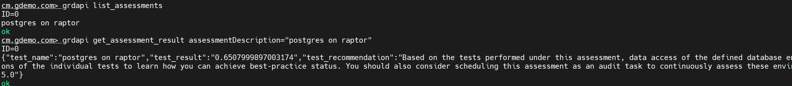{ width="99%" }](../images/varesults6.webp)

1.	The solution is to create reports whose content can then be retrieved by an external service through a *REST API*. In the **cm** UI, open the **Query Report Builder** and note that there are three reporting domains related to vulnerability assessment:
    - **VA Summary** – does not meet our requirements
    - **VA Tests** – stores information about the definitions of all available tests
    - **Security Assessment Result** – stores information about all executions and the value of each test

    [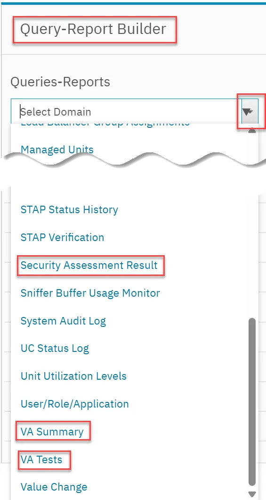{ width="39%" }](../images/varesults7.webp) 

1.	Let’s take a closer look at the structure of the first mentioned reporting domain. To do this, create a new report in the *Security Assessment Results* domain named **VA - Assessment executions (Training)**. Expand the list of entities in the *Main entity* field and notice that the domain consists of several tables, with the most important for our scenario being:
    - Assessment Result Header – stores information about all vulnerability assessment executions
    - Test Result – stores detailed information about the results of each test for every execution
    - Assessment Result Datasource – stores configuration information related to access to the analyzed system. In our first report, we will use Assessment Result Header as the Main entity.

    [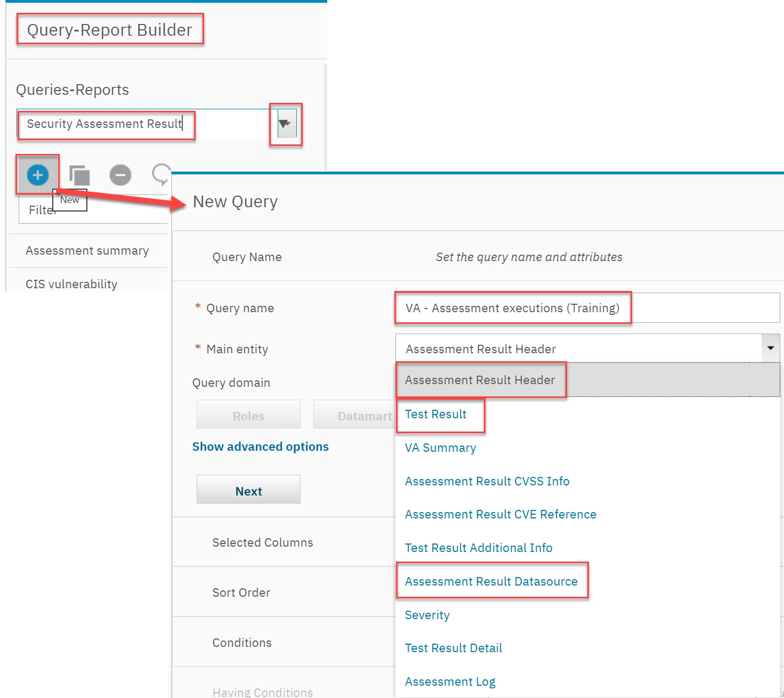{ width="99%" }](../images/varesults8.webp)
 
1.	Place four columns in the report, all from the *Assessment Result Header* table:

    !!! note "Report columns:"
        - Assessment Result Header: **Execution Date**
        - Assessment Result Header: **Assessment Id**
        - Assessment Result Header: **Assessment Description**
        - Assessment Result Header: **Assessment Result Id**

    [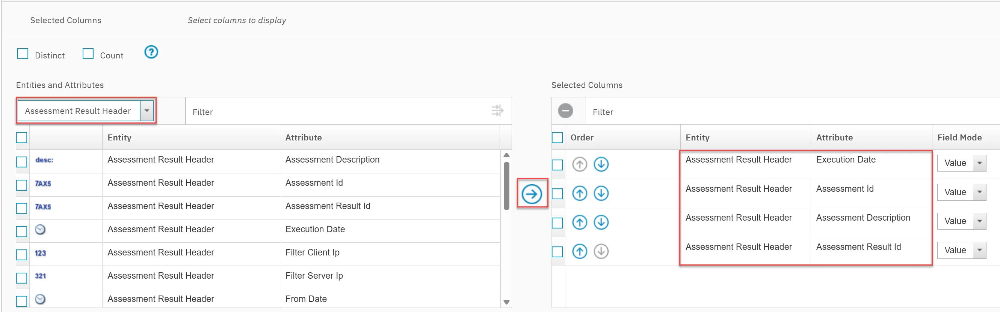{ width="99%" }](../images/varesults9.webp)
 
1.	Set a descending sort order for vulnerability assessment executions based on the *Execution Date* parameter. **Save** the report.
[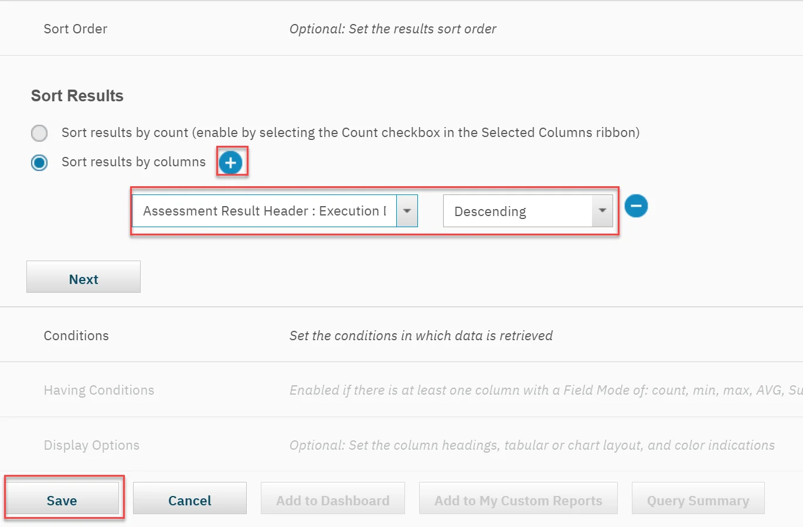{ width="99%" }](../images/varesults10.webp)

1.	Go to the dashboards section and create a new dashboard named **VA** (**Save** the name). Then use the **Add Report** button to select the report we just created, *VA – Assessment executions (Training)*, from the list. The selected report should now appear in the dashboard area.
[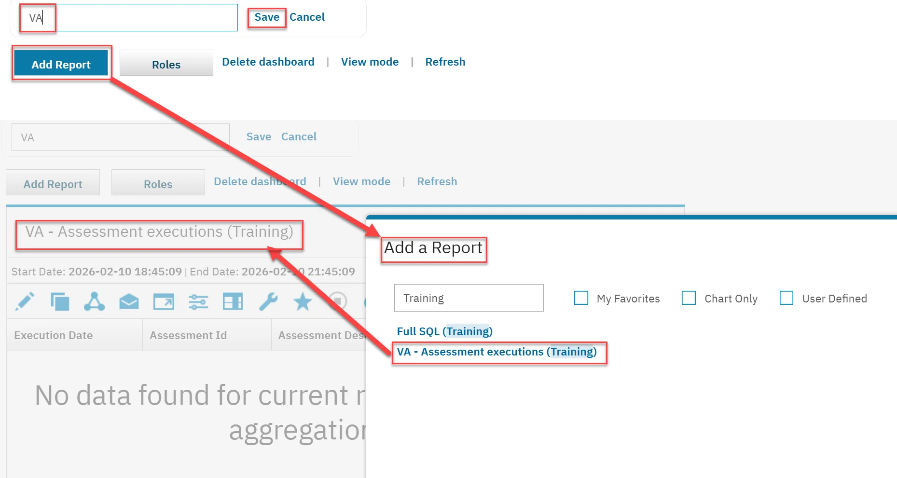{ width="99%" }](../images/varesults11.webp)
 
1.	Change the report configuration using the configuration icon { width="16" } and set *Enter Period From* to the value **NOW − 60 DAY**. Save the configuration changes and observe that all executions of the **postgres on raptor** assessment are now displayed, each with its unique *Assessment ID*. Every execution is also assigned its own unique *Assessment Result ID*.
[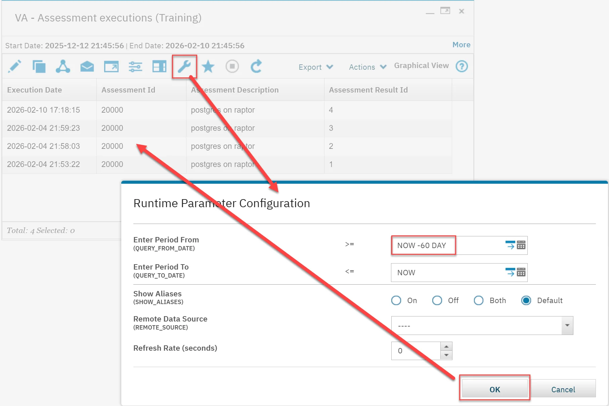{ width="99%" }](../images/varesults13.webp)
 
1.	Go back to the **Query Report Builder** and create a new report in the **Security Assessment Result** domain. Name the report **VA - Assessment Result Set Values (Training)** and select **Assessment Result Datasource** as the *Main entity*, then proceed to the *Selected Columns* section.
[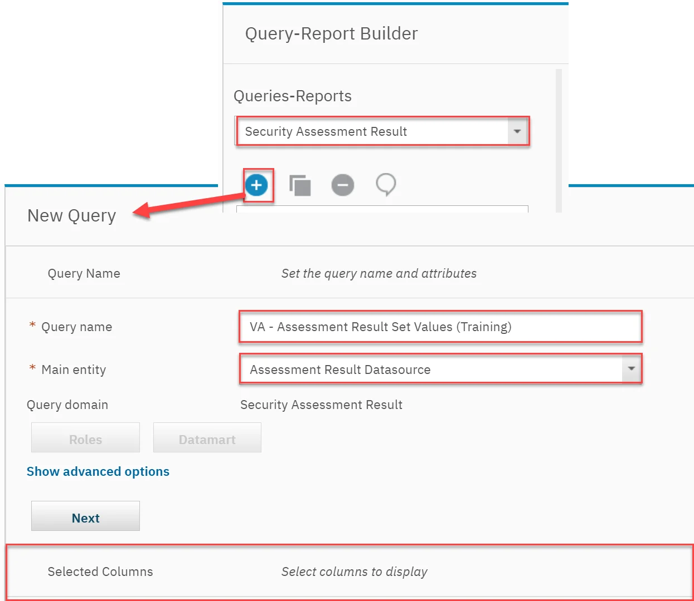{ width="99%" }](../images/varesults14.webp)
 
1.	Add the following field to the report:

    !!! note "fields:"
        - Assessment Result Header: **Assessment Result Id**
        - Test Result: **Test Id**
        - Test Result: **Result Text**
        - Test Result: **Result Details**
        - Test Result: **Test Score**
        - Assessment Result Datasource: **Assessment Result Datasource Id**

    The first field represents the identifier of the executed assessment process (the instance)- this is the key that links this report with the previous one. The fields from the Test Result table provide information about the identifier of the executed test, the returned message and its details, and a value indicating the status of each individual test execution, where:

    !!! note ""
        - `1` means the test passed,
        - `0` means the test failed,
        - `-1` means an error occurred during execution.

    The last field identifies the resource on which the test was executed. After adding the fields to the report, proceed to the *Sort Order* section.

    [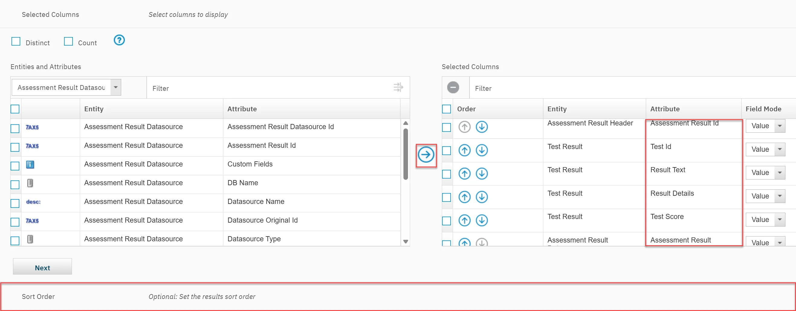{ width="99%" }](../images/varesults15.webp)
 
1.	Sort the report in ascending order by the **Test Id** field and proceed to the *Conditions* section.

    [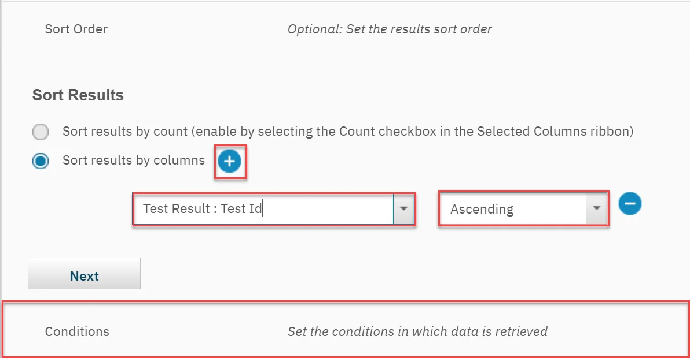{ width="89%" }](../images/varesults16.webp)
 
1.	Use { width="16" } icon to add a new condition. Define that the **Assessment Result Id** field in the report must have a value **LIKE** the value provided by the dynamic **Parameter** we named **ResultSetId**. Then **Save** the report and go to the dashboards.
[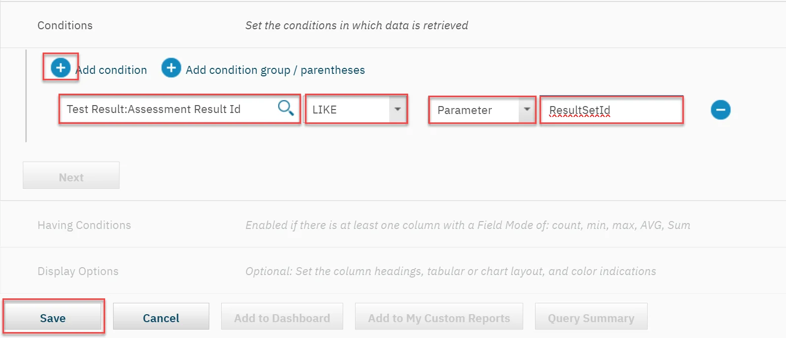{ width="99%" }](../images/varesults18.webp)
 
1.	Open the *VA* dashboard, and in its edit mode the **Add Report** button will become active. Use it to locate the report we created and select it so that it is added to the dashboard.
[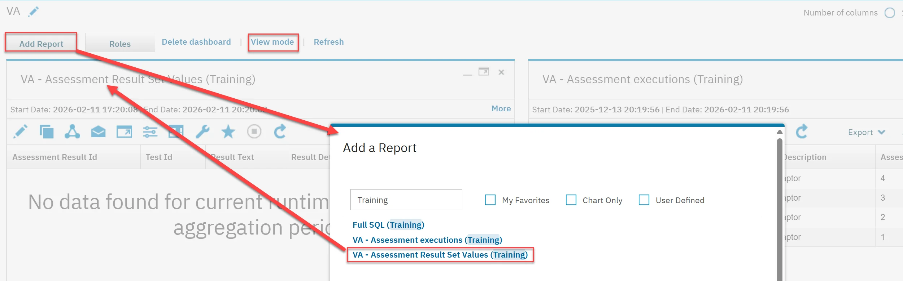{ width="99%" }](../images/varesults19.webp)
 
1.	Use { width="16" } icon to open the report configuration. Set its time range to *60 days* and observe that our dynamic parameter *ResultSetId* has taken the default value **%**, which means any sequence of characters. In other words, the report will display all result sets.
[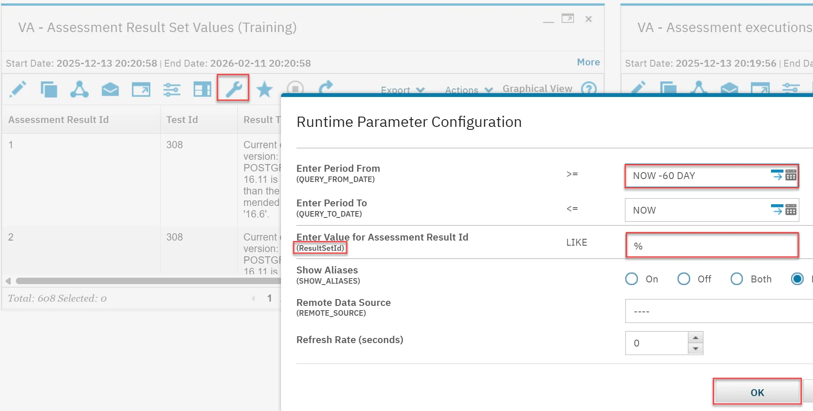{ width="99%" }](../images/varesults21.webp)

1.	Let’s take a look at the report. You will probably see several result sets (1, 2, 3, 4), and each of them contains a passed check (value 1) verifying that the *PostgreSQL* version is higher than the recommended **16.6** (**Test Id 308**). So why do the data source **IDs** differ, given that the tests were executed against the same source named **postgres on raptor**? We need to remember that the data source definition may change between executions. Because of this, each result set is assigned a snapshot of the data source configuration to ensure that the assessed component is correctly identified for that specific run (you see different **Test Id** and executions, but logic will be this same).
[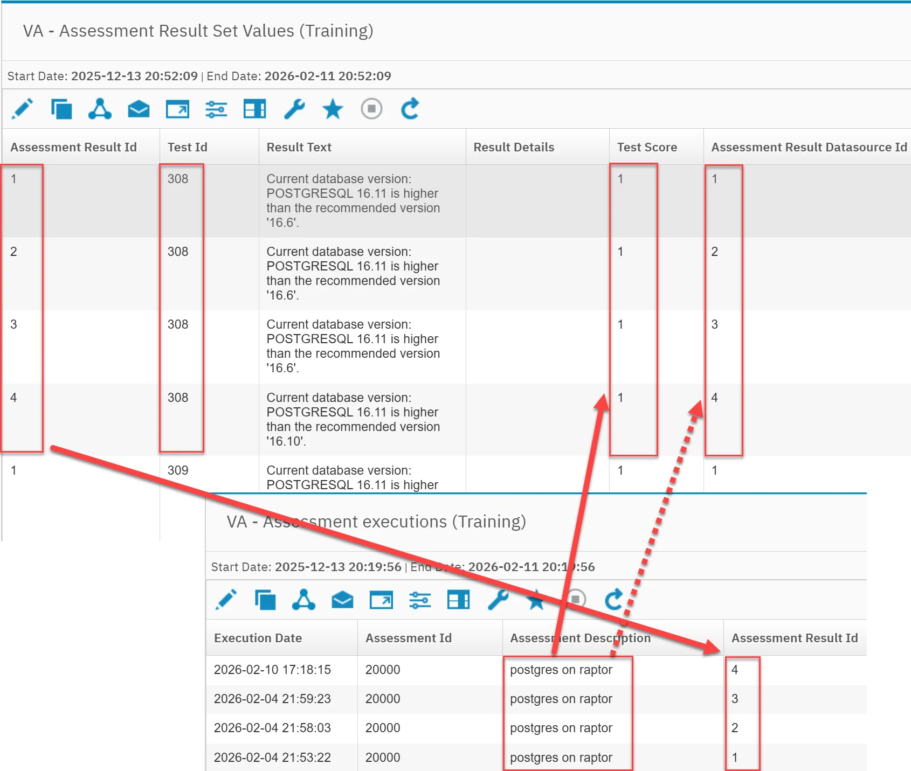{ width="99%" }](../images/varesults22.webp)
 
1.	Edit the report again and apply a filter so that it shows only the latest result set (number 4 in the screenshots). After doing this, the number of displayed test values will be reduced (152 in the screenshot example).
[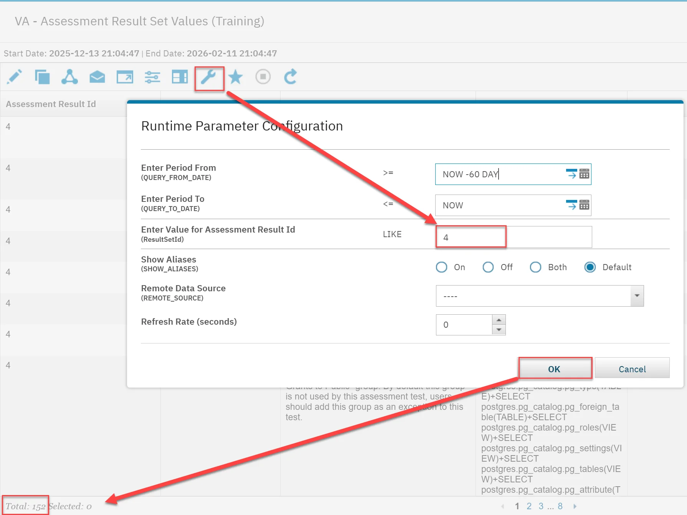{ width="99%" }](../images/varesults23.webp)
 
1.	Open the latest report in the **Assessment Builder** for the **postgres on raptor** process and notice that it contains exactly the same number of results as the report we generated.
[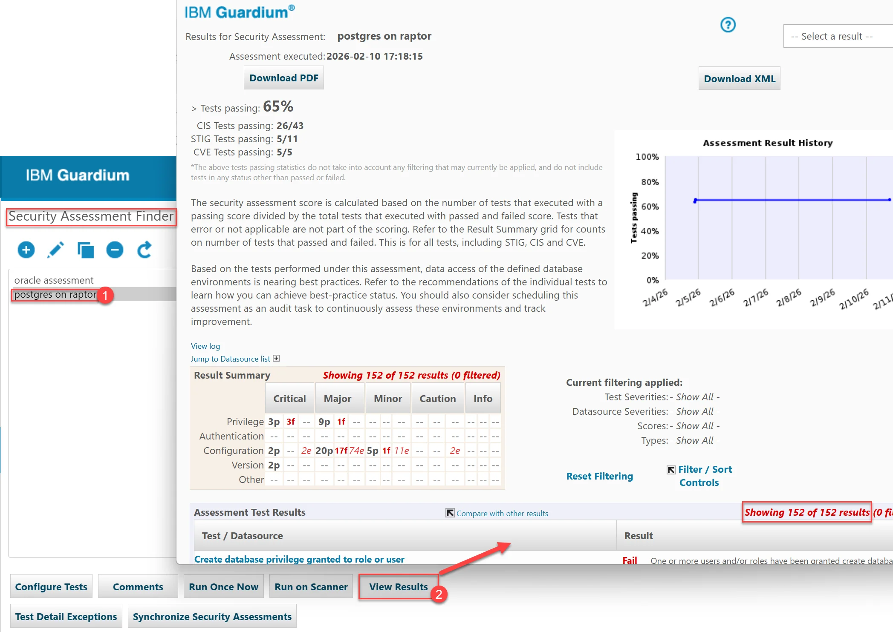{ width="99%" }](../images/varesults24.webp)
 
1.	Scroll through the vulnerabilities report and notice that besides the **Pass** and **Fail** states, you will sometimes find others. These states are not included in the overall assessment result, but at least two of them **-1** (Error) and **-13** (Pre Test Check Failed) should be monitored. A decision should be made whether to ignore them or adjust the system configuration to allow the test to be evaluated correctly.
[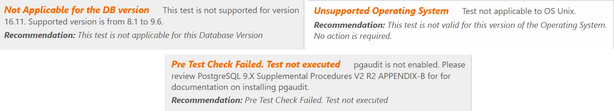{ width="99%" }](../images/varesults25.webp) 

1.	Filter the results using the pop up window activated by the **Filter/Sort Controls** option. Then, while holding the ++ctrl++, select the following Scores: **Fail**, **Pass**, **Error**, and **Pre Test Check Failed**. Confirm by clicking **Apply** and observe that only the subset of results that matter is now displayed. Then close *VA* results window.
[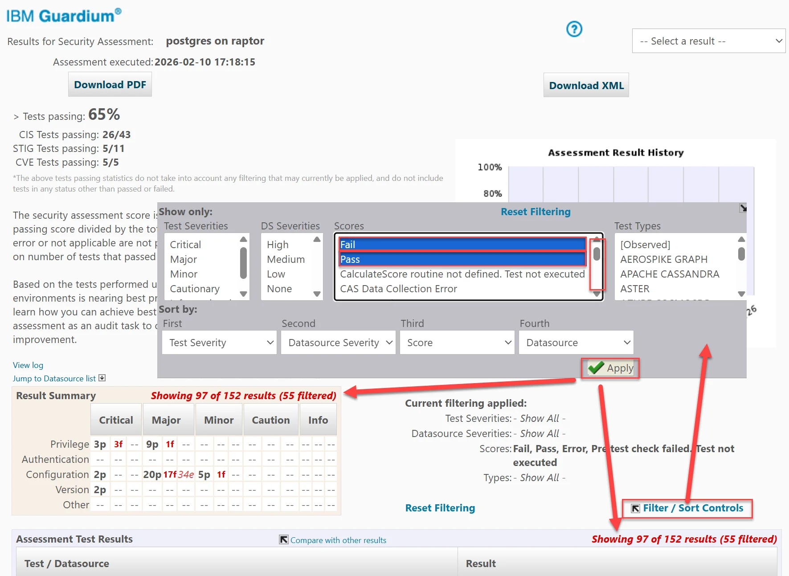{ width="99%" }](../images/varesults26.webp)
 
1.	Let’s now try to modify our report so that it displays test results only for those entries that have meaningful values. To do this, we will first create a group containing the list of *Test Score* values that are relevant to us. In the **Group Builder**, use { width="16" } icon to create a new group named **VA - Interesting test scores (Training)**. In the *General* tab, choose **Public** as the *Application type* and **Text** as the *Group Type*.
    
    [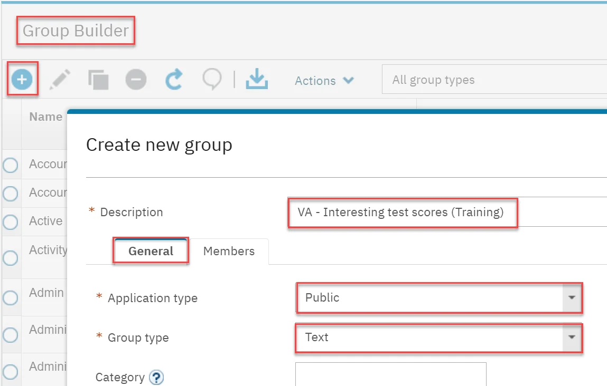{ width="79%" }](../images/varesults27.webp)
 
1.	In the *Members* tab, add the following values to the group: `1`, `0`, `-1`, and `-13`, and then **Save** the group definition.
[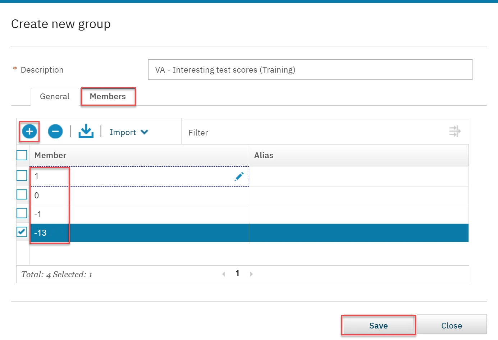{ width="99%" }](../images/varesults28.webp)
 
1.	Open the *VA* dashboard and edit the report *VA - Assessment Result Set Values (Training)*. In the *Conditions* section, add another condition specifying that only those results should be displayed for which the *Test Score* takes values defined in the group *VA - Interesting test scores (Training)*. Add one more condition: the *Test Score* value will be a parameter named *TestScore*, which will allow displaying only a specific type of result if needed. Then **Save** report.

    !!! note "report parameters:"
        - **Test Result:TestScore** `IN GROUP` **VA - Interesting test scores (Training)**
        - **Test Result:TestScore** `LIKE` **Parameter:TestScore**
    
    [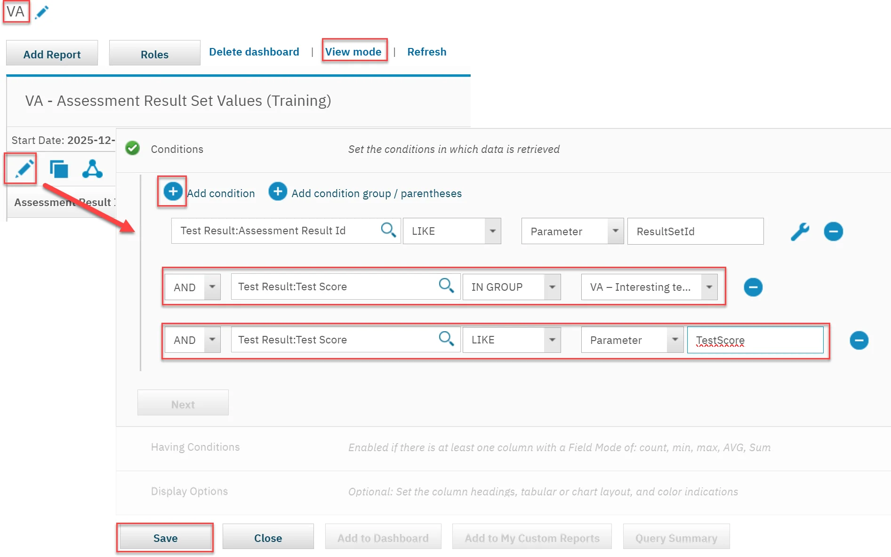{ width="99%" }](../images/varesults29.webp)
 
1.	Refresh the report so the updated definition is reflected in the dashboard, and notice that the report now contains fewer results because it displays only those with scores defined by the values in the group.
[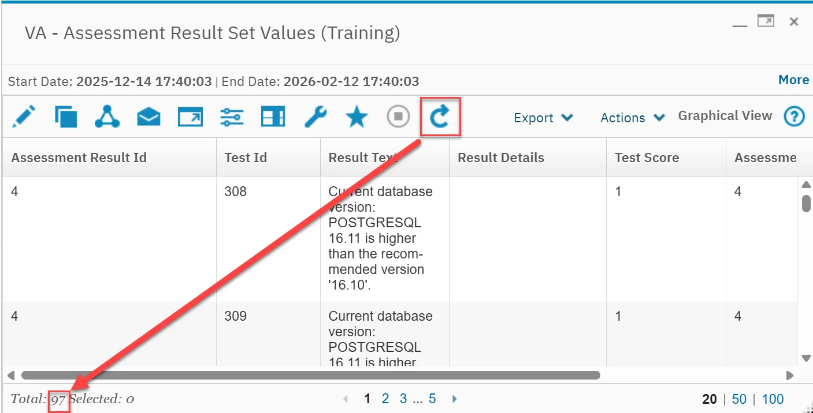{ width="99%" }](../images/varesults30.webp)
 
1.	Create another report in the **Query Report Builder** within the **Security Assessment Result** domain. The goal is to retrieve detailed information about the datasource (the vulnerability assessment target) whose results appear in the previous report. Name the report *VA - Assessment Datasources (Training)* and build it with the *Main entity* set to the **Assessment Result Datasource** table.
The report should contain 9 columns:

    !!! note ""
        - Assessment Result Datasource: **Assessment Result Datasource Id**
        - Assessment Result Datasource: **Datasource Type**
        - Assessment Result Datasource: **Version Level**
        - Assessment Result Datasource: **Service Name**
        - Assessment Result Datasource: **Datasource Name**
        - Assessment Result Datasource: **Host**
        - Assessment Result Datasource: **Port**
        - Assessment Result Datasource: **DB Name**
        - Assessment Result Datasource: **User Name**
 
    It is important to enable the **Distinct** option in the *Selected Columns* section so that only unique values are displayed.

    In the report, configure descending sorting based on the **Assessment Result Datasource Id**, and add one dynamic parameter using a **LIKE** condition, also based on this Id, and name it **DataSourceID**.
    
    [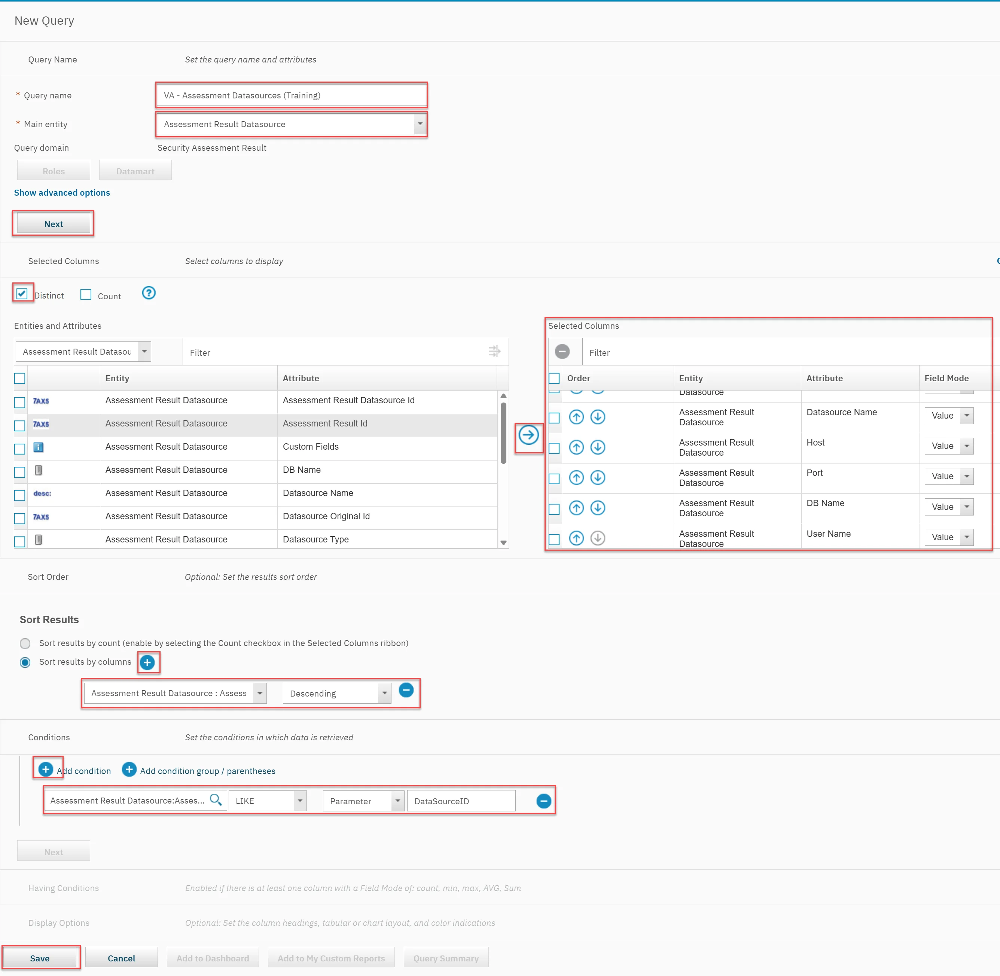{ width="99%" }](../images/varesults31.webp)
 
1.	Close the window and add the newly created report to the *VA* dashboard. Set it to display data from the last *60 days*, and notice that it shows a separate data source definition for each result set. This ensures proper identification of the assessed target even if its configuration changes over time.
[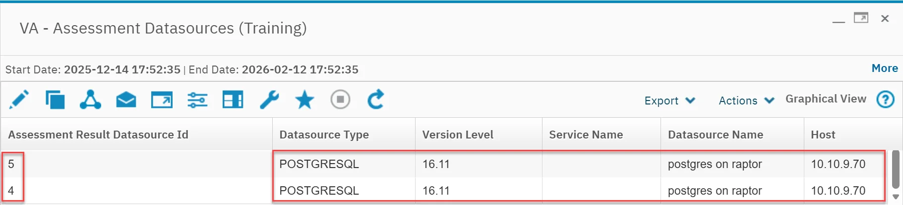{ width="99%" }](../images/varesults32.webp)

## Add more assessment definitions

1.	Go back to the Assessment Builder view and add a new configuration using   button. Enter the name oracle assessment and proceed to the list of data sources using the Add Datasource button.
 
1.	In the Select Datasource window, use   icon and fill out the Create datasource form. Choose Oracle (Direct - Service Name) as the Data type, which will display the required configuration elements. Then enter the following data:
Name: oracle on sauropod – local
Description: Oracle 21c local instance
User name: system
Password: <default tech user password in the lab>
Host name/IP: sauropod.demo.guardium
Port number: 1521
Service name: ORCLPDB1
Next, Save (1) the definition, which will enable the Test Connection button (2). Use it to confirm that communication is possible and then Close the window.
 
1.	The data source definition we just created for the Oracle database should now appear in the Select datasource window. Select it and Save the change.
 
1.	This will return you to the vulnerability assessment process builder view, and the newly created datas ource will now appear in the Datasources section.
 
1.	Add an additional data source according to the information provided below, and include them in the assessment process.
Data source 2
Name: oracle on sauropod - container
Data type: Oracle (Direct – Service Name)
Description: Oracle 21c in container
User name: system
Password: <use the default service password >
Host name/IP: 10.10.9.70
Port number: 1522
Service name: ORCLPDB1
1.	Finally, in the Datasources section, you should have four data sources. Then save the configuration using the Apply button, which will activate the Configure Test button. Select it.
 
1.	In the Assessment Test Selections view, first choose the type of database engine to be analyzed. In our case, select the ORACLE tab (1). This will display the list of available tests below. Before selecting them, uncheck the Include CAS option (2). Now select the first test in the list, scroll to the last one, and select it while holding the Shift key. This will highlight all available tests (3). Then click the Add Selections button (4).
 
1.	After a moment, the selected tests should appear in the upper section, and the list at the bottom should be empty. Press the Return button to go back to the Assessment Builder view.
 
1.	Run the vulnerability assessment you have just configured.
 
1.	And after a moment, confirm its completion in the Guardium Job Queue view.
 
1.	In the VA - Assessment executions (Training) report, a new instance of the assessment process will appear, associated with the oracle assessment. Notce that the new process we created has a different Assessment Id, and its execution is associated with a new result set (Assessment Result Id).
 
1.	Configure the VA - Assessment Result Set Values (Training) report so that it displays the results for the new result set generated by the oracle assessment. Notice that almost every test appears in the report four times, and each of those four instances is associated with one of the four data sources defined in the assessment. This behavior reflects exactly how the process was built.
To summarize: each assessment run creates a unique result set, and for every data source used in the assessment process, its configuration snapshot is stored independently.
 
1.	Edit the VA - Assessment executions (Training) report and add the field Assessment Result Datasource Id from the Assessment Result Datasource table. Notice that the system will propose displaying a counter instead of actual values. This happens because of the relationship between the main report table defined in the Main entity (Assessment Result Header) and the table from which this field originates. This relationship is 1:N — one assessment execution produces one result set, but it may be associated with one or more data sources.
 
1.	Cancel the report modification and let’s create a new report in the Security Assessment Result domain. Name the report VA - Assessment Result Sets (Training). It will contain the same parameters as VA - Assessment executions (Training), but this time the Main entity will be set to Assessment Result Datasource. It’s important to note that while almost all elements of an existing report can be modified, the Main entity cannot — which is why we must create this report from scratch.
Add the following fields to the report:
•	Execution Date, Assessment Id, Assessment Description, Assessment Result Id — all from Assessment Result Header
•	Assessment Result Datasource Id — from Assessment Result Datasource
This time, the data source ID value can be displayed directly. Remember to enable the Distinct option in this section.
Configure two descending sort conditions:
•	by Execution Date (the vulnerability assessment run time)
•	by Assessment Result Datasource Id
Do not add any conditions. Save the report and add it to the VA dashboard.
 
1.	Set the report to display data from the last 60 days and review its content. Now you can clearly see that the execution of the oracle assessment is associated with a single result set, which is linked to four analyzed database systems.
 
1.	Modify the dynamic parameters of the VA - Assessment Result Set Values (Training) report and add the option (LIKE) to filter by the Assessment Result Datasource Id column from Assessment Result Datasource. Name this parameter DataSourceId.
 
1.	The results report displayed a consolidated list of all tests for the selected result set.
 
1.	Thanks to the new parameter, we can now narrow the results down to a specific system analyzed during the assessment. In practice, all three dynamic parameters will later allow us to retrieve each individual test result separately.
 
1.	Earlier we mentioned that assessment results (Security Assessment Result domain) are stored separately from test definitions (VA Tests domain). This separation makes sense: static data such as test definitions change rarely, while dynamic data—assessment results from dozens, hundreds, or even thousands of database systems—arrive continuously.
This separation, however, means we cannot directly display test results together with the full definition of each test in a single report. Guardium does provide a way to merge these datasets into one report, but it requires building a custom reporting domain.
Our goal, though, is to allow an internal system to consume assessment results. In this case, the separation of static and dynamic data is an advantage rather than a limitation. Let’s therefore build a report that allows us to retrieve the full definition of a test.
 
1.	Name the report VA - Tests (Training) and set the Main entity to Assessment Tests. In this report, all columns will come from the same table as the Main entity. These columns are:
•	Test ID – the unique identifier for each test
•	Datasource Type – identifies which database engine type the test applies to (e.g., Oracle, DB2)
•	Test Type – User Defined JDBC Based, JDBC Based, APAR, CVE, CAS Based
•	Short Description – short description of the test
•	Test Description – test name unique for the datasource type
•	Severity – Critical, Major, Minor, Caution, or Info
•	Category – VER (patch level), PRIV (data access), CONF (misconfiguration), AUTH (authentication weaknesses), OTHER
•	STIG Reference – indicates whether the test is part of STIG hardening and its reference
•	External Reference – other hardening references such as CIS, Community, or vendor-specific guidance
•	Threshold – if the test is based on a threshold comparison, the value is shown here
•	Threshold Default Value – default threshold values used by the test
Sort the report in ascending order by the Test Id field.
Add one dynamic parameter with the LIKE operator on the Test Id field – name parameter TestId. Save the report and add it to the VA dashboard.
 
1.	The report displays all available tests, and the dynamic parameter allows you to reference each test individually.
 
III.	
Setup REST API key for VA results consumption	1.	Log in through the CLI on the cm and display the list of existing OAUTH clients. Run the following command, which displays the existing ones. The list will likely include a key related to the VA scanner configuration from a previous lab.
grdapi list_oauth_clients
 
1.	Register a new API client named va api. Make sure to note the generated secret key, as it will be required for authentication when invoking API functions.
grdapi register_oauth_client client_id=va-api grant_types="password"
 


## VA Test Retrieval Using REST API

1.	Run the script, inserting your environment details: the OAuth client secret generated for the API client, your Guardium account username, and its password. Note that the score type is set to -1, so the output should include all results where the test ended with an unexpected error.
cd /opt/guardium_tz_bootcamp_automation

. activate_venv.sh

python3 tools/va-api.py --appliance cm.demo.guardium --client-secret '<your_secret>' --user demo --password '<demo_user_password>' --score-type -1 --client-id va-api
 
1.	This simple script retrieves from the VA - Assessment Result Sets (Training) report the list of all vulnerability assessment executions, and then, for each execution, displays the results from VA - Assessment Result Set Values (Training) per datasource. Information about the datasource and the test definition is fetched from the VA - Assessment Datasources (Training) and VA - Tests (Training) reports, respectively.
1.	Run the script again, but this time change the value of the score type parameter to 0. This will display all tests that ended with a fail result — meaning the system does not meet the required security criteria.
python3 tools/va-api.py --appliance cm.demo.guardium --client-secret '<your_secret>' --user demo --password '<demo_user_password>' --score-type 0 --client-id va-api

Appendix	Dependencies:
This lab requires that ATAP, VA and Oracle labs are fully covered before

To do:
-	Exceptions and detail exception example
-	Possibility to get specific test from specific run on specific datasource

Resources:


